# FXRoute Manual

FXRoute turns a small Linux audio PC into a browser-controlled music and DSP system. A phone, tablet, or laptop on the local network controls playback, switches DSP presets, compares filter banks, imports filters, routes outputs, and runs room measurements — the audio machine itself needs no screen.

This is the user manual. The [README](README.md) covers the feature overview, installation, and the web demo; [docs/INSTALLER.md](docs/INSTALLER.md) covers the installer and streaming providers in depth.

Screenshots show the Beta 14 frontend in the web demo. Playback, example presets, and measurements are simulated; they are not measurements of your room. Click an image to view it at full resolution.

## 1. What FXRoute is for

FXRoute assumes one audio machine running a Linux user session with an active PipeWire stack (desktop, or headless with user services enabled).

On that machine, FXRoute provides:

- a web interface for local music, internet radio, Spotify, Qobuz, TIDAL, and Bluetooth or external line input
- a native DSP engine that all playback enters through (`fxroute_dsp_sink`)
- one output-routing model that assigns logical roles to hardware outputs in **Stereo**, **Stereo + Sub**, or **Surround**, plus per-way crossover and bass management
- surround playback from a digital S/PDIF input (Dolby Digital or DTS Core), decoded into the routed speaker roles (section 5.6)
- DSP presets per filter bank, A/B compare, filter imports, and correction workflows
- room and speaker measurement that feeds PEQ and FIR/convolver preset creation
- control of the whole setup from browsers on the local network

Spotify, Qobuz, and TIDAL integration is unofficial and builds on community backends and protocols.

FXRoute exposes its web UI on the LAN. Keep it on a trusted network.

## 2. Install and first start

Three supported ways to get FXRoute onto the audio machine:

- **Classic install.** `git clone https://github.com/CobbyCode/fxroute.git && cd fxroute && ./install.sh`. The installer prepares system packages, builds the native DSP engine and the surround ingress helper, creates the Python virtualenv, and enables the `fxroute.service` user service. Run it as the audio user; from a root shell pass `--user <name>` when the host has several users. Supported package managers are apt, dnf, zypper, and pacman.
- **ARM64 Armbian image (Raspberry Pi 4 / Pi 5).** Write the image, boot, and finish the web onboarding; first boot installs FXRoute and enables the `.local` name and HTTPS. See [docs/INSTALL-ARMBIAN.md](docs/INSTALL-ARMBIAN.md).
- **x86_64 installation ISO.** The Ubuntu 26.04 ISO (`Install FXRoute Headless`, `Install FXRoute Desktop`, `Try FXRoute Live`). Write the ISO, boot, pick a profile, and complete the installer.

Streaming providers are optional and are managed later in **Technical settings → Providers**; the installer flags select the same backends, e.g. `./install.sh --providers spotifyd,qobuz,tidal`. Provider installs and updates always resolve the current stable upstream release — no provider version is pinned.

Open FXRoute from any browser on the same network:

- `http://fxroute.local:8000` (default name; change it in **Technical settings → Device Name**; the downloadable images install a unique id, e.g. `http://fxroute-ab12cd.local:8000`)
- `http://<host-ip>:8000`
- `http://localhost:8000` on the audio PC itself

With the optional local HTTPS proxy enabled, `https://<host-ip>` and `https://<device-name>.local` also work; HTTP on port 8000 stays reachable.

The service is `fxroute.service`. Quick host commands:

```bash
systemctl --user status fxroute
systemctl --user restart fxroute
journalctl --user -u fxroute -f
```

On a volatile `Try FXRoute` live session the interface shows a **Live Mode** banner: changes and logins are not saved and are lost after reboot.

## 3. The interface

The main tabs are **Radio**, **Library**, and **DSP**, plus the provider tabs **Spotify** and **Qobuz** once installed, enabled, and shown. TIDAL has no tab: it lives inside the **Library** (see 4.5). The FXRoute logo in the top-left opens **Technical settings**; the power menu next to it can **Suspend** or **Shut down** the audio PC when the host supports it.

The playback bar at the bottom is always visible:

- play/pause, previous/next, seek, shuffle/repeat where the source supports them, and the current queue
- the **volume slider is the FXRoute master volume**, the main listening level
- the level badge shows the live peak against the DSP chain; radio and library rows show stream tech lines (codec, bitrate, sample rate)
- click the current cover to open the detail card with metadata, "Recently played" where the source provides it, and the queue

Source and app volumes (Spotify client, Qobuz app) stay separate from the FXRoute master volume. The compact source switcher next to the transport controls selects between app playback, an external input, Bluetooth input, and STDIN.

### 3.1 Remote and keyboard control

FXRoute works from a sofa without an air pointer. A TV remote that sends standard keyboard keys behaves like a keyboard:

- **Arrow keys** move the focus ring to the nearest button, card, tab, menu entry or slider. Left/Right stay in the current row (e.g. Library view tabs to the search field) and only leave it when the row has nothing further in that direction. Down walks the rest of the page (e.g. the DSP tiles below Tone effect) before it reaches the playback bar at the bottom.
- **Enter** activates the focused control exactly like a click (buttons, rows, cards, checkboxes). On a dropdown it opens remote-friendly choices: arrows move, Enter confirms, Escape/Back cancels. Mouse and touch still open the native dropdown.
- Album and saved-station cards are the primary navigation stops: Left/Right move between cards within the same row and stop at its edges; Down moves to the next row. Up focuses the card's favorite heart; Down returns to that card, another Up moves to the card above. OK on a heart only changes the favorite, never opens or plays the card. The same rule applies in grid and list layouts; cards without a heart navigate directly upward. Refreshes preserve focus; removing a favorite selects the next remaining card (or the previous card at the end).
- Track lists (album, playlist and TIDAL details; Library tracks, playlists and folders): Up/Down move from row to row on the round Play buttons; Left/Right move within the row between Play, the selection Plus, the heart and the row's actions, and stop at its ends. Moving down into a list, or the first arrow key after opening an album or playlist, focuses the first track's Play button. The detail's Back button is reached with Up from the first track, never from inside a row. A heart keeps the focus while it saves.
- In DSP, Left/Right walk an effect's controls in order (e.g. Upmixer → Mode → FFT → Surround) without jumping into another effect, and stay among the DSP cards beside each other. The opposite arrow retraces the same controls.
- **Escape** leaves a text field or a dropdown without changing the page.
- The playback bar at the bottom is one zone with the same rules for Radio, Library, TIDAL and Spotify: Left/Right move along its row (cover, favorite heart, transport buttons, volume) and stop at its ends, Down from the transport buttons reaches the seek slider, and Up from the seek slider returns to them. Only Up from the top row leaves the bar, onto the nearest control above it that is in view; Left, Right and Down never jump into the page.
- The cover in the playback bar is the first stop of that row whenever something is loaded, also without artwork, and OK opens the now-playing details. Back closes them and returns to the cover.
- **Page Up / Page Down** switch to the next/previous tab of the active tab strip (Page Up goes right, Page Down goes left).
- **Home** (the remote's Home key arrives as Browser Back, also Alt+Left) steps back one tier per press. In a dialog, dialogs stacked on top close first; then the first dialog returns to its main view (in the Measurement assistant: menus and Setup close, the assistant stays open); then it closes. On the page, Home closes the power menu, open panels (Import) and detail views and keeps the current tab. With nothing left to close it opens Technical settings, and the next press closes them. FXRoute keeps a history guard entry, so Back, Home and the mouse back button never leave the app for the browser's start page.
- **Backspace** (the Back key of the remote) works one level at a time: it closes the top dialog or returns from a detail view.
- **Context menu key** opens and closes the audio input picker, including during app playback; the browser's keyboard context menu is suppressed. Mouse right-click is unchanged.
- Sliders (volume, seek) are navigation stops: Left/Right move on like for any other control. OK arms the slider (ring and thumb turn accent) and Left/Right then change the value; OK again, Back or Up/Down ends the adjustment. With Tab or the mouse a slider keeps its native keys. Closed dropdowns and text fields reached by the remote are navigation stops, not arrow-key traps. Enter starts text editing; Up/Down leaves a single-line editor. Tab keeps normal keyboard focus and caret behavior.

Power, volume and mute keys keep their system behavior. Media keys (Play/Pause, Next, Previous, Stop) control the active FXRoute source from any keyboard or remote, even when the browser does not have the focus. FXRoute registers its own media player with the desktop (MPRIS; on GNOME the media-keys daemon) and takes the keys back from paused players such as Spotify Desktop, so Spotify is only controlled while it is the active source. With an external, Bluetooth or STDIN input selected, media keys do nothing.

[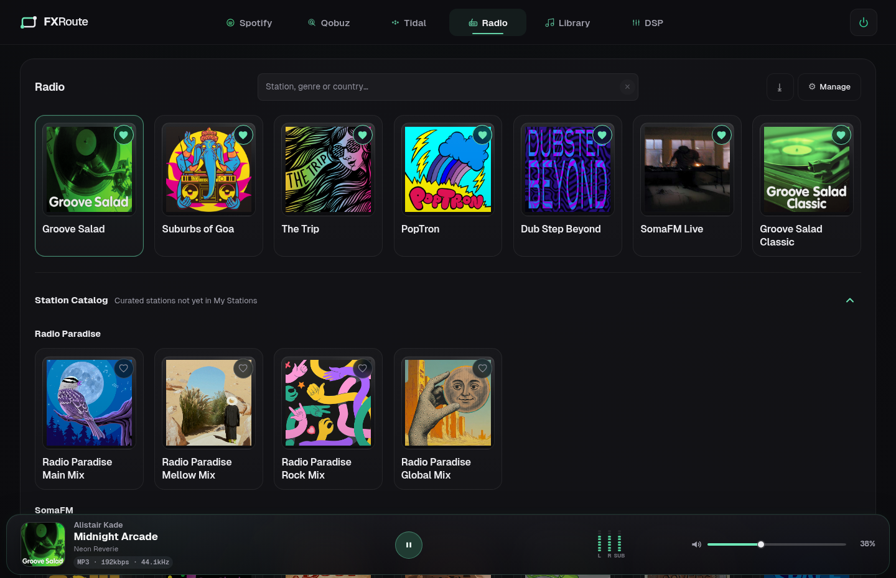](media/screenshots/radio-overview.png)

## 4. Sources

### 4.1 Radio

Play from **My Stations** (your saved streams) or from the **Station Catalog** of curated stations. Radio lets you:

- search Radio Browser by station, genre, or country; low-quality streams are filtered out and results are grouped into My Stations, Station Catalog, and Web Results
- add, edit, and delete personal stations, with custom artwork. SomaFM streams are added directly from the URL; other streams need a name
- export your station list (JSON) and import stations by dropping a JSON array onto the station URL field
- see live metadata and artwork for stations with dedicated providers (Radio Paradise, FIP, SomaFM, KEXP) in the current-track card; only SomaFM also supplies a "Recently played" list

Curated stations appear under **Station Catalog** until you add them to **My Stations**. Search-result and catalog cards add a station to My Stations; only My Stations cards start playback.

### 4.2 Library and network shares

**Library** plays music from the local folder or from a network share, in **Albums**, **Tracks**, **Artists**, **Folders**, or **Favorites** view, with a grid/list toggle for albums and artists. The upload hint lists the accepted formats: *Upload MP3, FLAC, WAV, OGG/Opus/WebM, M4A, M3U/M3U8, or ZIP.* Multi-select per track, or **Select all** for everything currently visible, drives **Download selected** (single file or ZIP) and **Delete selected**.

- **Import** offers *Import from URL* (paste or drop a YouTube or direct media link) and *Upload audio file, playlist, or album ZIP*. Uploads land in the managed `incoming` folder under the music root.
- **Playlists** are created and updated with **Save as playlist…**: saving under an existing name replaces that playlist's tracks; **Delete** removes it. Playlists are shown as cards in Favorites and as rows in Tracks/Folders, and can be exported as M3U8 or imported from `.m3u`/`.m3u8` files (including playlists inside an album ZIP). A selection of local tracks saves a local playlist, a selection of TIDAL tracks saves a TIDAL playlist, and a mix saves one FXRoute playlist that holds the tracks in the order you added them, the TIDAL tracks as references (marked with the TIDAL glyph). It plays as one queue; while TIDAL is not connected its TIDAL entries stay listed, dimmed, and are skipped ("Starting 7/9 tracks"). The M3U8 export cannot contain TIDAL streams: it leaves them out, names them in comment lines, and says so in a message.
- **Favorites** collects favorited albums and your playlists, plus two smart mixes: **Top 40** (your most-played tracks, ordered by play count only) and **Favorite Tracks** (every hearted track, local and TIDAL, played as one queue). Individual tracks and albums are favorited with the heart in their row/card; there is no bulk favorite action.
- **Artists** lists every artist from your music tags: the album artist, or the track artist for compilations and untagged files. A "feat." credit is split: the main artist and each guest get the track, while joins such as "&" stay as one artist and the track tags are left unchanged. An artist page shows About, the artist's albums and tracks, and **Discover Similar**. With TIDAL connected, TIDAL favorite artists join the list (matching names merge into one entry), artists get their TIDAL image and heart, and a matching artist's page adds an **On TIDAL** section with top tracks and albums. Without TIDAL the view is purely local.
- **Search** in Albums, Tracks, Artists, or Favorites opens a results view with the tabs **Albums**, **Tracks**, **Artists**, and **Playlists** (it starts at the category you searched in). Each tab lists **In your library** first (local items and your TIDAL favorites), then **TIDAL** (the TIDAL catalog, only while TIDAL is connected; otherwise a Connect hint). **Enter** searches TIDAL at once, **Esc** clears the search. In Folders and inside an open album or playlist the search filters in place.
- Album detail shows label, genres, an "About this album/artist" summary, and a **Discover Similar** section with similar artists (from the album artist's MusicBrainz id). A similar artist you have in your library opens its page; with TIDAL connected the others open on TIDAL.

FXRoute treats local tags and cover files as authoritative and enriches albums opportunistically with cached MusicBrainz release and artist ids, Cover Art Archive covers, artist/album summaries, and similar-artist suggestions. Enrichment runs a few albums per scan with long cooldowns, so scans stay fast; unchanged tracks are cached by path, mtime, and size.

The active library is selected in **Technical settings → Music Library**. FXRoute discovers accessible SMB shares (neighbour table plus a local-subnet sweep, keeping only listable disk shares); a share that is not found can be added manually as `smb://server/share` through *Add network share manually…*. A manually entered share is kept for the running session only — re-enter it after a service restart, or make sure discovery finds it. The host needs the installer-provided CIFS support to mount it.

### 4.3 Spotify

Spotify pairs through Spotify Connect, not a login inside FXRoute: install the backend in **Technical settings → Providers**, open the Spotify app on a phone or computer, and select the FXRoute device. Two backends are supported:

- **Spotify Desktop** — the official client on an x86_64 desktop session, controlled through MPRIS. A current client can also deliver Lossless streams for eligible Premium accounts; FXRoute only provides the remote control, not the stream.
- **spotifyd** — a headless player for sessions without a desktop. The installer pins its Zeroconf port so phones find the FXRoute player reliably. Lossless is not available through spotifyd.

Which backend is active is shown in the tab tooltip. The tab offers play/pause, next/previous, seek, shuffle, repeat, volume, cover art, and track metadata. Metadata follows the local player, so track changes update without a manual refresh. When the backend is idle the tab says **Ready for Spotify Connect.**; when it is not running it explains how to start it. Spotify may trigger a Linux keyring unlock prompt after login (on XFCE, install and set up `seahorse` first).

### 4.4 Qobuz

The Qobuz tab controls a **Qobuz Connect** player (`qbzd`) on the audio PC. Connect the account in **Technical settings → Providers**: press **Connect**, open the shown sign-in link, paste the redirect URL back, and confirm. If `qbzd` is present but never set up, the row offers **Complete setup…** plus **Restart**. Playback starts from the Qobuz app by selecting the FXRoute device; the tab then offers the same transport controls as the other sources. Stream quality follows your Qobuz account and app settings. The Qobuz client runs at unity gain, so volume changes are handled by the FXRoute master slider.

### 4.5 TIDAL

TIDAL is part of the **Library**, next to your local music. After installing the backend, the Library header shows a small **TIDAL** button: **Connect TIDAL** while you are signed out, a connected pill (click to refresh) afterwards. Connected, your TIDAL favorites join the Library: favorite albums in **Albums**, favorite tracks in **Tracks**, favorite artists in **Artists**, and favorite albums and playlists in **Favorites**, each marked with the TIDAL glyph. A TIDAL item opens its detail inside the Library; the heart favorites it on your TIDAL account, and the **+** button adds tracks to a selection that **Save as playlist…** turns into a TIDAL playlist, adds to an existing one, or saves together with local tracks (see 4.2). Searching in the Library also searches the TIDAL catalog. TIDAL audio runs through FXRoute's DSP chain and playback bar like local files, and consecutive album tracks at the same sample rate play gaplessly. When a queue continues by itself, a TIDAL track that cannot be played is skipped and the next playable one starts. Without TIDAL the Library is purely local.

Sign in with the **browser login (PKCE)**: copy the login link, sign in on any device, paste the redirect URL back. This is the only method; it unlocks Lossless and Hi-Res playback. (The former device-code login, limited to AAC 320 kbps, is gone; a session made with it keeps working until you disconnect.)

Disconnect in **Technical settings → Providers**; playback stops until you sign in again. Your TIDAL library and favorites stay on your TIDAL account.

### 4.6 Bluetooth and external input

**Technical settings → Source** selects the active input: **App playback** (the default), **External input: …** for a detected stereo line/loopback source, **Bluetooth input** when the host stack supports it, or **STDIN** for a piped PCM stream. The Bluetooth status line reports the adapter state, the connected device, and the active codec. A lone mono capture is not offered as external input. An interface that exposes each of its inputs as its own mono capture (for example the Behringer UMC204HD) is the exception: its inputs are paired in order, so Input 1 and Input 2 appear as one stereo input, with Input 1 on Front L and Input 2 on Front R. Switching away from Bluetooth input unlinks the DSP route while preserving the Bluetooth stereo connection. A saved external input that disappears stays selected, is marked unavailable in the switcher and the settings select, and is relinked when it returns.

External stereo input pairs use automatic signal recognition in **Stereo**, **Stereo + Sub** and **Surround** (section 5.6); no digital/analog setting or device-specific input assignment is needed. PCM, Dolby Digital (AC-3) and DTS Core are identified from the captured samples. Surround receives the discrete decoder channels; Stereo and Stereo + Sub receive a complete stereo downmix, with Center and each surround side at −3 dB and LFE at half gain per side before one shared, layout-dependent headroom normalization. Stereo PCM and encoded stereo retain unity gain. In Stereo + Sub, the downmix (including LFE) runs through the existing stereo bass management; its crossover distributes bass between Main and Sub. The helper runs at 48 kHz and adds 58.71 ms to PCM and encoded inputs alike; **Calibration → AV Sync** credits that existing delay instead of adding it twice. The overall AV target remains unchanged when it is still achievable; a smaller target cannot remove the helper's latency. Custom Mapping remains an explicitly mapped PCM path.

The recognition window is 2050 frames, included in the fixed 2818-frame input delay. A newly recognised preamble suppresses the whole still-pending prefix (up to 42.71 ms of PCM before the transition is lost by design); AC-3/DTS and layout switches stay on the same timeline. An unclassified startup prefix is suppressed if a preamble inside that first window identifies compressed input. After the final AC-3 burst, non-silent PCM resumes after about 106.71 ms (DTS-512: 128.04 ms). This safe fallback still waits longer than the longest IEC burst period, so unsupported compressed input is not mistaken for PCM; confirmed raw DTS has a separate, longer timeout covering its accepted sync intervals. The graph quantum must be 768 frames (forced while the helper is active); larger quanta and non-48-kHz clocks produce silence. `/api/audio/surround` reports worker reserve, queue backlog and discarded/missing frames. PipeWire link hops and TV latency are separate from the fixed AV Sync credit.

**Custom Mapping…** (last entry of **Technical settings → Source → Input**) maps the physical input channels of an audio device to FXRoute channels, for example the analog 5.1/7.1 outputs of an external upmixer or preamp that feeds a multichannel interface. Each device has at most one mapping. Choose the **Device** first: the list holds every connected interface with at least two input channels, not only the selected output, and a device that already has a mapping is marked as saved. Then choose the input for every channel (Front L and Front R are required, and an input can feed only one channel), optionally enter a name, and press **Save**. The mapping then appears in the Input list as **External input: <name>** and behaves like any other external input, including the footer switcher, **Auto** and the per-input output mode. Front L/R carry the stereo signal in every output mode; the other channels are used in **Surround** output mode, where they feed the program channels directly instead of the digital decoder. Opening **Custom Mapping…** again starts on the device of the selected mapping, otherwise on the selected output's device, and loads its saved mapping for editing; **Delete** removes it together with its input, and App playback takes over if it was the active input. The mapping belongs to its device and is offered in the Input list whichever output is selected, as long as the device is connected.

### 4.7 STDIN pipe input

Select **STDIN** under **Source → Input**, then run the pipeline as the FXRoute audio user. The CLI accepts raw interleaved PCM and sends it to the running FXRoute/PipeWire service; nothing is written to stdout and diagnostics go to stderr. Output continues through the configured FXRoute DSP and hardware routing.

```bash
ffmpeg -v error -i album.flac -f s32le -acodec pcm_s32le -ar 48000 -ac 2 - \
  | fxroute stdin --format s32le --rate 48000 --channels 2

sox input.wav -t raw -e signed-integer -b 16 -L -r 44100 -c 2 - \
  | fxroute stdin --format s16le --rate 44100 --channels 2

ffmpeg -v error -i movie.mkv -f f32le -acodec pcm_f32le -ar 48000 -ac 6 - \
  | fxroute stdin --format f32le --rate 48000 --channels 6

ffmpeg -v error -i multichannel.wav -f f32le -acodec pcm_f32le -ar 48000 -ac 8 - \
  | fxroute stdin --format f32le --rate 48000 --channels 8 --left 5 --right 6
```

**Options** (`fxroute stdin …`):

| Option | Meaning |
| --- | --- |
| `--format` | Required. `s16le`, packed 3-byte `s24le`, `s32le` or `f32le`. |
| `--rate` | Required. Sample rate of the pipe, 8000–384000 Hz. |
| `--channels` | Required. Channels per frame, 1–32. |
| `--left`, `--right` | Optional pair. 1-based pipe channels that feed the left and right program inputs; only the front pair is used. Give both. |
| `--channel-map` | Optional. The program channel of every pipe channel, in order (see below). Cannot be combined with `--left` / `--right`. |
| `--socket` | Optional. Overrides the path of the local FXRoute socket (default `$XDG_RUNTIME_DIR/fxroute/stdin.sock`). |

**Program channels.** A channel map names the eight FXRoute program channels: `FL` Front L, `FR` Front R, `FC` Center, `LFE`, `RL` Rear L, `RR` Rear R, `SL` Side L and `SR` Side R (`BL` and `BR` are accepted for `RL` and `RR`; names are not case-sensitive). `-` leaves a pipe channel unused.

**Default layouts.** Without `--left`, `--right` or `--channel-map`, the channel count picks the layout. The channel order is the one of WAV, ALSA and PipeWire, so a pipe from `ffmpeg`, `sox` or `pw-cat` usually fits as it is:

| `--channels` | Pipe channels 1, 2, 3 … |
| --- | --- |
| 1 | Mono, copied to Front L and Front R |
| 2 | `FL`, `FR` |
| 4 | `FL`, `FR`, `RL`, `RR` |
| 6 | `FL`, `FR`, `FC`, `LFE`, `RL`, `RR` |
| 8 | `FL`, `FR`, `FC`, `LFE`, `RL`, `RR`, `SL`, `SR` |

Every other channel count (3, 5, 7 and above 8) has no default and needs `--channel-map`, or `--left` and `--right`.

**Explicit channel map.** For any other layout, list the program channel of pipe channel 1, 2, 3 … separated by commas:

- Front L and Front R are required, every program channel may appear once, and the map may stop before `--channels`; the pipe channels after the last entry stay unused.
- A 5.1 pipe whose surround pair belongs on the side speakers: `--channels 6 --channel-map FL,FR,FC,LFE,SL,SR`.
- A 7.1 pipe whose channels 5 and 6 are the side pair (the default expects the rear pair there): `--channels 8 --channel-map FL,FR,FC,LFE,SL,SR,RL,RR`.
- 10 pipe channels of which only the first eight are speakers: `--channels 10 --channel-map FL,FR,FC,LFE,RL,RR,SL,SR`.
- A stream with a gap, Center on channel 4 and nothing on channel 3: `--channels 4 --channel-map FL,FR,-,FC`.
- Left and right swapped: `--channels 2 --channel-map FR,FL`.

`--left` and `--right` remain the short form for picking a stereo pair out of a wider stream (`--left 5 --right 6` equals `--channel-map -,-,-,-,FL,FR`). The CLI refuses an invalid selection (a program channel named twice, an unknown name, a missing Front L or Front R, a map longer than `--channels`, or a map together with `--left` / `--right`) with exit code 2 before it connects.

**Output modes.** The map decides where the channels go in each output mode (section 5.3):

- **Stereo** and **Stereo + Sub** use the front pair only, exactly as before: `FL` and `FR` feed the left and right program inputs, and the other channels are read but not played. There is no downmix; use `--left` / `--right` or a map to choose which two pipe channels are the front pair.
- **Surround** feeds every mapped channel directly to its program channel: Center, LFE, Side and Rear reach their speakers, the Surround fold-down and bass management apply as for any Surround source, and an unmapped program channel stays silent. The front pair then takes the same direct path as the other channels, so all channels stay time-aligned.
- A stream that maps only the front pair (every mono and stereo stream and every `--left` / `--right` stream) behaves the same in every output mode.
- Changing the output mode while a stream is playing moves it to the route of the new mode; the front pair never plays twice. A change of output device or routing and an engine restart relink the stream by themselves.

Under **Technical settings → Source** the STDIN status line shows the format, rate, channel count and routing, for example `f32le · 48 kHz · 6 ch · 1 → FL, 2 → FR, 3 → FC, 4 → LFE, 5 → RL, 6 → RR` (`5 → L / 6 → R` for a `--left` / `--right` pair).

The client may connect before STDIN is selected and then waits for selection. Exit code is 0 after `done`, 2 for CLI/metadata errors, 1 for runtime errors, 130 for SIGINT and 143 for SIGTERM. A fixed sample-rate policy resamples the pipe stream to the graph rate; STDIN never changes the graph clock itself. An active measurement session stops a running STDIN stream and blocks new writers until it is released; the stream does not resume, so start the pipeline again afterwards. The amplifier power hint (section 10) reports `stdin` for a playing multichannel stream as for any other.

### 4.8 Input auto-select

While a line source is active, the **Auto** button next to the footer source switcher arms the shown input. External inputs and STDIN can be armed; the switcher list itself stays plain and the Auto button carries the state. FXRoute then watches every armed input in the background and switches to it as soon as it carries a signal, pausing app playback like a manual switch. When that signal has ended for good, FXRoute returns to the selection that was active before the automatic switch. A manual selection ends the automatic one and becomes the selection the next automatic switch returns to. The button highlights while the shown input is armed, shows a dot while that input carries a signal, and glows while the current input was selected automatically; its tooltip reports the detection state, for example *Auto · signal detected (Dolby Digital)* or *Auto · no digital lock · switches here when a signal is detected*. The **App** button at the start of the switcher returns to app playback directly.

- **Digital inputs (S/PDIF):** activity is the digital stream itself: PCM above dither level or an encoded bitstream (Dolby Digital, DTS, AAC/MPEG via IEC 61937, raw DTS). Exact digital silence, null/pause bursts and a lost receiver lock count as no signal. Where the card reports its S/PDIF lock (for example USB Audio Class 2 "S/PDIF Validity"), a lost lock returns after 10 s.
- **Analog inputs:** about one second of programme level (−50 dBFS RMS) arms; peaks above −60 dBFS keep it active.
- **STDIN:** a connected `fxroute stdin` writer is the signal; the return follows 10 s after the last writer disconnected.
- Pauses, track changes and quiet passages do not return: only 60 s without signal (10 s for a removed input) does. When two armed inputs carry signal, the one selected first keeps the route and the other takes over when it ends.
- After a manual switch away, ongoing signal does not undo the selection. One second without signal rearms the input, so the next signal can select it again without waiting for the automatic return hold.
- While a measurement session owns the audio graph, auto-select is paused.
- Rate changes, channel-tier reprobes and DSP graph rebuilds fence local capture activity. Monitoring restarts on the settled graph with a fresh attack; samples and decisions from an earlier graph or probe cannot select an input. Capture gaps longer than 300 ms restart the attack. A new local claim also needs qualifying data no older than 750 ms; the longer signal-end hold does not qualify a new claim.
- Scarlett 16i16 4th Gen capture channels 9–10 are recognized as S/PDIF even when the source name is generic. An explicitly lost digital lock blocks local activation; an unknown lock still permits signal-based detection. A lock alone never counts as programme. Fresh external HTTP presence remains an independent trigger and is reconsidered once graph work settles.
- Automatic-switch journal entries identify the input, local audio / HTTP presence / STDIN trigger, peak and RMS level, lock, data age and graph/probe generation. External presence value changes are logged without repeating unchanged heartbeats. Returning to App playback does not restart a stopped track.

## 5. DSP

Open **DSP** to shape the sound. The **Measure** button on this page opens the measurement assistant (section 6). The **Import** button opens the filter import panel.

FXRoute routes every source through one output-routing model. A **mode** decides which roles exist, **Output Routing** assigns those roles to hardware outputs, and the active assignments define the **topology** — which in turn defines the filter banks, the crossover card, the subwoofer card, and what a measurement sweep excites.

[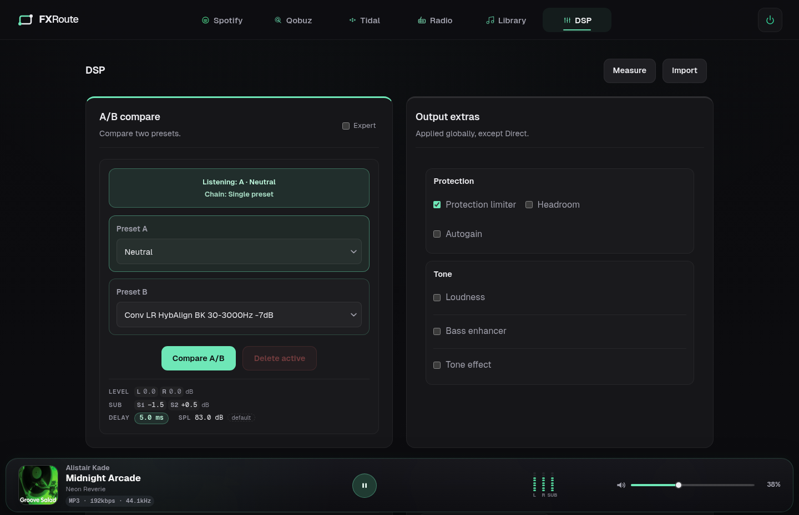](media/screenshots/dsp.png)

### 5.1 Presets, filter banks and A/B compare

- **Presets** are selectable chains. **Direct** bypasses the whole processing chain including the global helpers; it belongs to the **Global** bank and is not offered in an area bank. **Neutral** is a clean chain that keeps the helpers active and is the default in every bank. Both are built in and cannot be deleted.
- **Every bank has its own preset and IR library.** A preset name is unique within its bank, not in the installation: two banks may both hold a preset called `Room`, and combining, deleting, downloading and importing always name the bank they act on. An area bank keeps its presets and its impulse responses in its own folders; the **Global** bank has one library per output mode, so Stereo, Stereo + Sub and Surround no longer share global presets and a preset created in one of them is not offered in the others. A convolver preset owns the IR file it was built from, and that file belongs to the same bank, so two banks can hold kernels of the same name. Preset and IR files of an installation from before this layout — the former flat `presets/` and `irs/` folders — are not read any more: recreate or re-import them once. The old files are left untouched on disk. A bank is what the selected output routes right now: a speaker whose pair partner is not routed is a bank of its own (a lone `Sub L`, for example), and a bank that is not routed — that former pair, or the crossover ways while Crossover is off — keeps its presets and assignments but is not offered in the Bank selector; create, import, combine, delete, download and IR upload are refused until it is routed again. A library folder counts as a bank only under a bank id an output mode can define; any other folder, a library backup for example, is neither listed nor written to.
- **Easy and Expert.** The A/B compare card opens in the **Easy** view: it works on the **Global** bank only and shows no bank selector, and Measure, Import, Combine and Delete act on Global as well. The **Expert** switch at the top right of the card shows the full bank selection described below, Global included. The switch changes only the view: filters selected in the individual banks keep playing in Easy, and Expert returns to the bank selected there before. The choice is kept per browser; the Output extras are the same in both views. Pure Stereo has no bank selection and shows no switch.
- **Filter banks** decide which part of the system a preset (and a measurement) applies to. Pure Stereo (only Main L and Main R routed) keeps the single **Global** bank and shows no bank selector. As soon as the topology has more than Main L/R, the Expert view shows a **Bank** selector above the preset slots: **Global**, **Ind. Banks**, each complete stereo pair (**Main L/R**, **Low L/R**, **Low-Mid L/R**, **Mid L/R**, **High L/R**, **Sub L/R**) and each routed mono sub (**Sub 1**, **Sub 2**). In **Surround**, Global holds one PEQ or convolver preset per speaker group (**Front L/R**, **Center**, **Side L/R**, **Rear L/R**), selected separately in Preset A and Preset B. The Measure sweep menu and the chips in the Import, Combine, and Create PEQ panels all share the same speaker-group selection (section 5.6). The remaining Surround banks are **Ind. Banks** and the routed areas — **Front L/R** (with Crossover On, the way pairs), **Center**, **Side L/R**, **Rear L/R**, and **Sub 1** / **Sub 2**. The per-role bindings behind a bank are kept, so an older installation with different left and right presets survives.
- **A/B compare** switches between two presets in the selected bank while you listen. **Global** switches the whole-mode preset; in Surround it switches the whole group selection of the slot. A concrete bank switches only that bank. **Ind. Banks** switches the configured area banks jointly. Preset A and B choose the slots; the header shows which side is active, and below Listening and Chain the card lists the active preset of the other banks of the active output mode — Global first when it is not the selected bank, numbered banks in a row on the same preset sharing a chip (`Sub 1/2`), and the full name in the chip's tooltip when it is shortened. The selected bank is not repeated there; the Easy view lists only the area banks on a preset other than Neutral, and with **Ind. Banks** selected the list holds Global only. Pure Stereo has no bank selector and shows no chips. With **Ind. Banks** selected, the Preset A and Preset B slots list the preset each switched area bank plays on that side instead of a picker: a bank without a B reads *stays on A*, and in a mixed state each bank marks the side it listens to. Global stays out of those lists because Ind. Banks does not switch it, and the slots never collapse, so the tile keeps its shape. With Surround **Global** selected, Preset A and Preset B each hold one picker per routed speaker group that lists that group's presets plus **Neutral** and **Direct** (Direct bypasses every group and the global helpers). The filters of all groups in the listened slot run at the same time. An unassigned Preset B starts from **Neutral**: picking its first group changes only that group, and A and B may hold the same selection. Choosing **Direct** in any group replaces the whole slot with Direct, and no control clears B back to unassigned. The toggle reads **Compare A/B** for a concrete bank and for Ind. Banks alike; with Ind. Banks the status names the listened side only, for example `Listening: A · Ind. Banks` or `Listening: Mixed A/B`. The Compare button is hidden until the other side is available. The preset named in the status (after `Listening: …`) links to its file, downloaded from the selected bank, with that bank's IR files when the preset uses a convolver. **Delete active** opens a confirmation dialog to remove the listening preset from its bank (hidden on **Ind. Banks**); with Surround Global, the dialog lists every active group preset on the listened side so you can select which ones to delete, and deleting a preset returns its group to Neutral. Below the buttons the card summarises the calibration of the active output mode: the **Level** Matching trim of each routed speaker (L/R in Stereo; FL, FR, C, SL, SR, RL, RR in Surround), the **Sub** gains, the effective AV Sync **Delay**, and the **SPL** calibration (measured level and Loudness offset, or the 83 dB reference marked *default* until calibrated).
- **Combine** builds one preset from up to three presets in order. Both the sources and the result belong to the selected bank; a name another bank already holds is a new preset here. In Surround Global, group chips above the preset selects choose the speaker group of the combined preset (shared with Measure, Import, and Create PEQ).
- **Import filter** writes a new preset into the selected bank; the panel's `Target:` line names it (for example `Target: Low L/R · Stereo L/R` or `Target: Sub 1 · Mono`). In Surround Global, chips under the `Target:` line choose the speaker group the filter is for — **Front**, **Center**, **Side**, **Rear**, only the configured ones — and the imported preset belongs to that group only, exactly like a measured filter; a preset file is tagged with the chosen group, whatever group it carried. An import into a single bank stays bound to that bank. With **Ind. Banks** selected, Import is hidden because there is no bank to import into. A stereo bank offers two forms:
  - **Stereo file** — one file for both channels: a stereo `.irs`/`.wav` impulse response, an FXRoute preset `.json`, or a preset bundle `.zip`
  - **Left / Right** — one mono `.irs`/`.wav` per side, or REW filter text per side (a `.txt` file or pasted text). Both sides are required and must be the same kind: Left and Right REW text, or Left and Right impulse responses.

  A mono bank (a mono or dual-mono sub, or the Surround **Center** group) shows a single **Mono filter** field instead, which takes a mono `.irs`/`.wav`, REW text, a preset `.json`, or a bundle `.zip`.
- **REW import** reads both REW text exports: *Export filter settings as text* (`Filter 1: ON PK Fc … Hz Gain … dB Q …`) and *Export filter settings as formatted text* (a header row plus one row per filter, with or without the Bandwidth column). Only peaking filters (`PK`/`PEQ`) are imported; filters switched off in REW stay as disabled bands, empty `None` slots are skipped, and header and note lines are ignored. Any other filter type, or a filter line that cannot be read, rejects the whole import and no partial preset is created. Band limits are 20–20000 Hz, ±24 dB, and Q 0.1–100.
- **Create PEQ preset** builds paired left/right bands from scratch (a mono bank or the Surround **Center** group edits one set of **Mono bands**), up to 20 bands per side. Each band has a type — **Bell**, **Notch**, **Low shelf**, **High shelf**, **Low pass**, **High pass**, **Gain** (a level trim, shared by both sides), or **Delay** (0–500 ms; refused in Surround Global) — plus frequency (20–20000 Hz), gain (±24 dB), and Q (0.1–100). The **EQ mode** selects IIR, FIR, FFT, or SPM. The preset is written into the selected filter bank; in Surround Global, group chips at the top of the card choose the speaker group it belongs to.
- **Q means the same in every bank.** PEQ bands follow the RBJ definition that REW and Equalizer APO use, so a preset renders with the same bandwidth in the Global bank as in a way or sub bank, and a REW import keeps the Q REW calculated.
- **Way and sub banks** take PEQ and convolver presets only: at most one PEQ, in IIR mode, and one convolver per bank, and at most 32 biquad stages per output including the crossover filters. The FIR/FFT/SPM EQ modes and the output extras belong to the Global bank.

[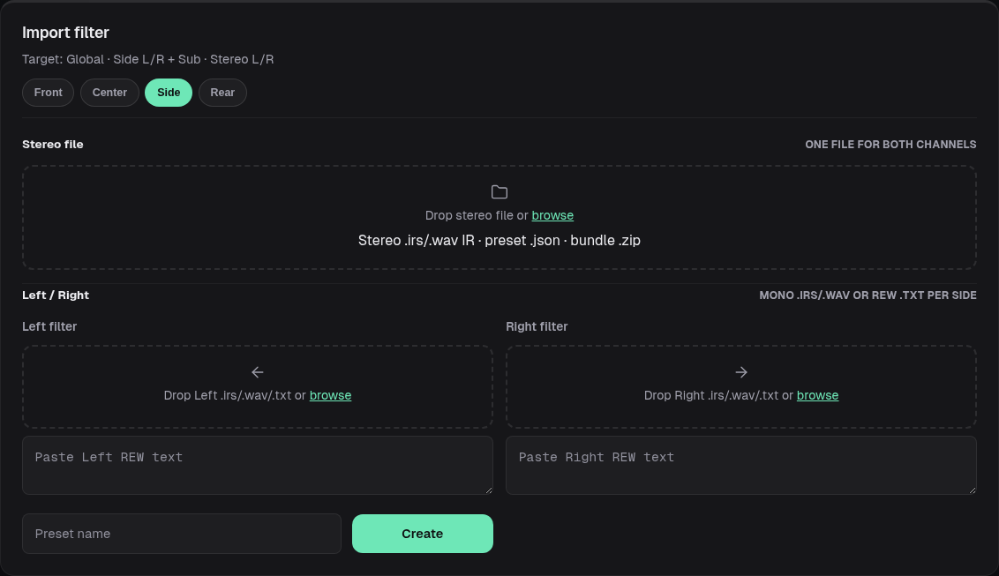](media/screenshots/preset-import.png)

*The Target line and speaker chips identify the group that receives the imported preset.*

### 5.2 Output extras

**Output extras** apply automatically on top of every preset except **Direct**:

- **Protection limiter** — protects the final output from peaks
- **Headroom** — safety margin from −1 to −9 dB (default −3 dB)
- **Autogain** — drives the programme level toward −12, −15, −18, or −23 LUFS
- **Loudness** — calibrated contour that follows the playback level; **Strength** (0–10; 0 leaves the tone unchanged, 10 compensates fully) and an **FFT** size (256–16384) set the contour. It works at its own DSP level and never moves the master volume; when Autogain is active, the contour accounts for the Autogain target too
- **Bass enhancer** — adjustable low-frequency enhancement (−20…+20 dB)
- **Tone effect** — **Crystalizer** or **Maximizer** modes
- **Upmixer** — Surround output mode only (section 5.6): derives Center and the surround channels from a stereo programme. **Mode** picks the engine, **Fast** (adaptive matrix) or **HQ** (spectral, with an **FFT** size). **Center** and **Surround** (0–10) set how strongly the steering extracts, 0 off for that share, 1 weak to 10 strong

Autogain and Loudness can run together; the limiter stays the final stage.

### 5.3 Output mode, crossover switch and output routing

**Technical settings → Audio Output** holds the device, the sample-rate policy, and three routing controls. On a two-output device the **Mode**, **Crossover** and **Output Routing** rows are hidden and the system is internally fixed to Stereo (Out 1 = Main L, Out 2 = Main R); three or more outputs expose them. For HDMI, the connected receiver's capacity determines the available routing outputs, not the currently active profile.

**HDMI profiles are selected automatically**; there is no Channels selector. FXRoute derives the required Stereo, 5.1 or 7.1 transport from the mode and the highest assigned output, limited by the receiver's reported LPCM channels and rates. Stereo normally needs two channels, Stereo + Sub at least 5.1 (default sub on Out 6, LFE), and Surround 5.1 or 7.1 according to the routing. Missing LPCM descriptors mean unknown capacity; PipeWire's detected channel count is used when available. An edit upgrades the profile when necessary, but does not immediately downshift it. The connection watcher checks every five seconds and waits for two consecutive narrower targets before reducing a still-supported profile, avoiding profile churn between edits. An unsupported profile falls back without that extra delay.

Routing is stored **per HDMI connector and mode**, shared across transport profiles; existing profile-specific assignments are retained during migration rather than overwritten. First-use defaults follow the actual hardware ports when their full order is available, otherwise standard ACP positions. Front L/R play Main, Center its speaker, and LFE Sub 1; Stereo and Stereo + Sub leave the surround speakers Off. In a six-channel HDMI layout ACP's single RL/RR pair represents the **Side L/R** surround speakers; 7.1 has separate **Rear L/R** and **Side L/R** groups. Existing saved Rear assignments stay unchanged. Explicit Side and Back channels in source material retain their positions; when only one surround group is routed, the other folds into it and uses the playing group's bass-management settings. Routing rows name receiver channels, for example `Out 5 · Center` or `Out 6 · LFE`; their order follows the device. HDMI carries one LFE channel, so the defaults never assign a second independent sub.

Profile changes do not restart the service and preserve an analog input of a combined profile, volume and mute. After receiver loss or replacement, FXRoute restores a supported profile for the connector's current routing instead of selecting another device. The watcher also reconciles profiles changed outside FXRoute. Connection/profile changes invalidate its ELD cache; an otherwise stable receiver is rechecked within 30 seconds.

**Mode** offers three values:

- **Stereo** — mains only (Main L/R, or the speaker ways when Crossover is On)
- **Stereo + Sub** — the same mains plus the sub roles (Sub L, Sub R, Sub 1, Sub 2)
- **Surround** — the front pair plus the surround speaker roles (Center, Side L/R, Rear L/R) and Sub 1 / Sub 2 (section 5.6)

**Crossover** is an independent On/Off switch next to Mode, not a third mode. Turning it On replaces Main with the speaker ways in the same routing (Main L/R become Low L/R); turning it Off maps Low back to Main and leaves the higher ways stored as **dormant crossover-path assignments**: their outputs read `Off` and stay silent, and switching the crossover back on restores the same ways on the same outputs. Presets, levels, delays, and polarities of the dormant ways are kept, so you can compare a 2-way and a 3-way setup without rebuilding them.

**Output Routing** is one row per hardware output (`Out 1`, `Out 2`, …), each with a role dropdown. The hint reads: *Assign a role to each hardware output. Off leaves an output silent.* Which roles are offered follows the mode and the crossover switch:

| Mode | Crossover | Roles offered per output |
| --- | --- | --- |
| Stereo | Off | `Off`, `Main L`, `Main R` |
| Stereo + Sub | Off | `Off`, `Main L`, `Main R`, `Sub L`, `Sub R`, `Sub 1`, `Sub 2` |
| Surround | Off | `Off`, `Front L`, `Front R`, `Center`, `Side L`, `Side R`, `Rear L`, `Rear R`, `Sub 1`, `Sub 2` |
| Stereo / Stereo + Sub | On | `Off`, the ways `Low L`, `Low-Mid L`, `Mid L`, `High L` and their `R` counterparts, plus the sub roles in Stereo + Sub |
| Surround | On | `Off`, the ways, `Center`, `Side L`, `Side R`, `Rear L`, `Rear R`, `Sub 1`, `Sub 2` |

One role may feed several outputs (fan-out); only the roles that actually appear are active. The **Mode** hint reads `<Mode> · <N> hardware outputs`; with **Stereo + Sub** selected but no sub role in the routing it reads *No subwoofer configured — assign a Sub output below.* until a sub is assigned. In **Surround** the hint also names the LFE target: `Surround · <N> hardware outputs · LFE → Sub 1 / Sub 2` (or `LFE → Sub 1` when only Sub 1 is routed, and `LFE → Front L/R` while no sub is routed). The line under the routing grid shows the derived summary, for example `Stereo · Mono sub`, `3-Way · Dual-mono subs` — and, when the routing is incomplete, the first problem:

- *Surround Sub 2 requires Sub 1*
- *Surround Side requires Side L and Side R*
- *Surround Rear requires Rear L and Rear R*
- *Stereo routing requires Main L and Main R*
- *Crossover requires complete Low/High, Low/Mid/High, or Low/Low-Mid/Mid/High ways*
- *Left and Right crossover ways must match*
- *At most two distinct sub roles are supported*

An incomplete routing is saved but not activated; the interface says so instead of silently ignoring it. Assignments are stored per device and per mode. With the crossover off, the ways of that other role domain stay dormant: their outputs show `Off` and the plan never drives them, so a plain Stereo / Stereo + Sub configuration cannot leak a crossover path onto an output — naming another role for that output replaces the dormant way. When a rate change makes a device expose fewer channels, the saved roles beyond the visible outputs are kept and come back with the tier. While a measurement is running the output state is locked.

**The sub configuration is derived, not selected.** The routed sub roles alone decide it, and the Subwoofer card badge names it: one sub role is a **Mono sub**, two distinct roles are **Dual-mono subs**, and the pair Sub L + Sub R is **Stereo subs** (Surround only offers Sub 1 and Sub 2, so it stays a Mono sub or Dual-mono subs). Older FXRoute versions and parts of the interface still call these *2.1*, *2.2* and *2.2 Stereo Bass*; those are labels for the same three derived layouts, not modes you can pick.

<p align="center">
  <a href="media/screenshots/output-routing.png">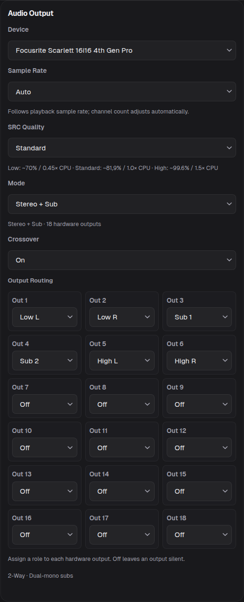</a>
  <a href="media/screenshots/surround-routing.png">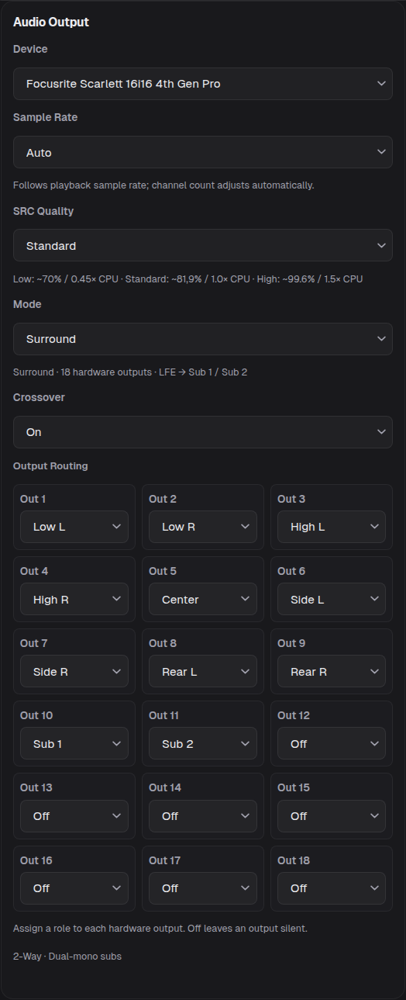</a>
</p>

*Left: Stereo + Sub. Right: Surround. Each mode keeps its own assignments; Crossover remains an independent switch.*

### 5.4 Crossover and speaker ways

The **Crossover / Speaker** card on the DSP page appears when Crossover is On and at least one speaker way is routed. The number of ways (2, 3, or 4) is derived from the routing, not chosen: each side must carry Low/High, Low/Mid/High, or Low/Low-Mid/Mid/High, and both sides must match.

- **Way tabs** list `Low`, `Low-Mid`, `Mid`, `High`. With **Link L/R** on they read `L/R · Low` and so on; with the link off they read `Left · Low` and `Right · Low` so each side is edited on its own.
- Each way has three control groups: **High-pass** (Frequency 20–20000 Hz, Type, Slope dB/oct), **Low-pass** (same), and **Trim** (**Level** −80…+24 dB, **Align** −40…+40 ms, **Polarity** Normal/Inverted (`N`/`I` on phone widths)).
- **Type** is `Off`, `Linkwitz-Riley` (12–72 dB/oct in steps of 12), `Butterworth`, or `Bessel` (both 6–72 dB/oct in steps of 6). The card and preview abbreviate these as `LR24`, `BW12`, `BS18`.
- **Type = Off clears that filter**: the way then runs open in that direction, the frequency and slope rows disappear, and the card summary names the open direction (`High-pass off` / `Low-pass off`). The preview draws that band the way it really runs, with a dashed curve. Re-selecting a real type restores a filter at the way's starter frequency.
- The first time a valid way set appears, FXRoute seeds Linkwitz-Riley 24 dB/oct starter values and says so: 2-way at 2000 Hz, 3-way at 300/2500 Hz, 4-way at 200/800/3000 Hz.
- While a subwoofer is routed, the **Low** way's high-pass is owned by the Subwoofer card. Its frequency is shown for reference with a `Set by the Subwoofer tile (…)` hint and cannot be edited here. In **Surround** this applies to the Front L/R ways, whose bass-management high-pass belongs to the **Front L/R** group in the Subwoofer card.
- The preview draws each way's cutoff lines; drag a line sideways to set that filter's frequency. The value follows the pointer in the **Frequency** field and is saved on release (with **Link L/R** on, for both sides). Only editable filters react: a filter set to **Off** and the Low way's sub-owned high-pass (drawn dashed) cannot be dragged.
- The card header summarizes the system, for example `3-Way Stereo System · Sub HPF 80 Hz · High-pass off`.
- **Link L/R** in this card is a UI convenience: it merges the tabs and copies the crossover filter values to the mirrored side. Way trim (level, align, polarity) always stays per side.

[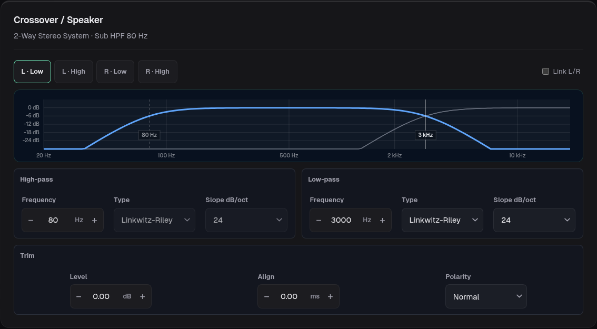](media/screenshots/crossover.png)

### 5.5 Subwoofers

The **Subwoofer** card appears on the DSP page when at least one sub role is routed. Its header shows the routed configuration (`Crossover 80 Hz · LR24 · Main HPF on`, or the two sides separately for an unlinked stereo pair) and the derived badge (`Mono sub`, `Dual-mono subs`, `Stereo subs`).

In **Surround** the card's **Global** group becomes the speaker groups **Front L/R**, **Center**, **Side L/R**, and **Rear L/R**, and it governs the bass management of each routed group: with **Link groups** on (the default) every group shares one crossover and the **Speaker highpass** switch; with the link off, each configured group has its own crossover type, slope, frequency, and high-pass switch, selected through the group tabs. The sub roles keep their usual **Level**, **Align**, and **Polarity** controls.

- **Global** (or the selected side, or the selected Surround group) group: **Crossover** 40–200 Hz, **Type**, **Slope dB/oct**, and **Main highpass** `On`/`Off` — in Surround it is labelled **Speaker highpass**.
- One control group per routed sub role, labelled with the role name (`Sub 1`, `Sub 2`, `Sub L`, `Sub R`), each with **Level** (−24…+12 dB), **Align** (−40…+40 ms), and **Polarity** Normal/Inverted (`N`/`I` on phone widths).
- **Derived delays** are shown for reference in a two-sub layout: `Main: … ms · Sub 1: … ms · Sub 2: … ms`.
- The preview draws the sub low-pass and the main high-pass with a cutoff marker, and can be dragged to set the crossover frequency directly.
- A **Mono sub**, a **Dual-mono** pair, and a **linked stereo pair** all share one crossover, so their subs cannot drift apart. Only a true Sub L + Sub R pair offers **Link L/R**; with the link off the card shows a `Sub L` / `Sub R` tab pair and one side at a time, each with its own crossover frequency, type, and slope. The **Main highpass** switch is shared in every layout. In Surround the link switch is labelled **Link groups** and links the speaker groups instead; Sub 1 and Sub 2 always share the same mono bass bus.
- Mono and dual-mono subs are fed by both channels summed at half gain, so they are excited from either side; in Surround both sub roles receive the same summed mono bass bus; a true Sub L + Sub R pair is side-fed. A dual-mono or mono sub is also a **mono** filter bank: paired PEQ bands must match, and a convolver impulse response must be mono.
- Subwoofer routing needs a selected multichannel output with at least three channels; subs summed from both sides need a channel count that covers the mode.

[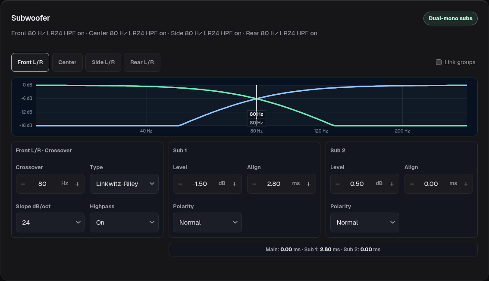](media/screenshots/subwoofer.png)

### 5.6 Surround output mode

**Surround** is the third output mode (section 5.3); like Stereo + Sub it is offered on devices with three or more hardware outputs, and the mode rows stay hidden on a two-output device. The mode is remembered per input — app playback, each external input pair, Bluetooth input, and STDIN each keep their own mode, so switching sources restores the layout that source was left in. With an external input selected, its capture pair runs through the surround ingress (section 4.6).

- **Routing and roles.** **Front L** / **Front R**, **Center**, **Side L** / **Side R**, **Rear L** / **Rear R**, and **Sub 1** / **Sub 2** are assigned as usual in **Output Routing**; Side and Rear must each be a complete L/R pair, and Sub 2 requires Sub 1. Sub L and Sub R are not Surround roles. With **Crossover** On, the front pair splits into the speaker ways while Center, Side, Rear, and the subs stay available; fan-out to several outputs still works.
- **Filter banks.** **Global** exists in Surround as one PEQ or convolver preset per speaker group (**Front L/R**, **Center**, **Side L/R**, **Rear L/R**); each preset holds the filters of one group. Preset A and Preset B select a preset for every routed group, and the filters of all groups run at the same time. The group for a new measurement is chosen in the Measure sweep menu, and the group for an imported, created, or combined preset with the chips in the Import, Create PEQ, and Combine panels (section 5.1); a created or imported filter keeps its own name, belongs to that group only, and takes its group's place in the listened slot, while the other groups keep theirs. A group's filter runs on that group's effect pairs ahead of the output matrix and the bass-management split, so the correction covers the speaker and its share of the sub bus; LFE is no group and no plugin targets it. A group without a routed speaker folds into another one, so its filter stays out of the chain, and a delay band is refused because it would shift every group. The area banks are **Front L/R** — with Crossover On, the way pairs — plus **Center**, **Side L/R**, **Rear L/R**, and **Sub 1** / **Sub 2**. **Global A/B** switches the whole group selection at once; **Ind. Banks** (Expert view) switches the area-bank A/B slots jointly — its Preset A and Preset B slots list what each switched bank plays on that side (section 5.1) — and can be measured as the whole system as listened (section 6.2).
- **Fold-down instead of silence.** A programme position without its own speaker is folded into the routed speakers rather than muted: Center to Front L/R at −3 dB each, Side to Rear (or Rear to Side) at unity, and to Front L/R at −3 dB when neither surround pair is routed. A measurement sweep excites only the speaker that owns a position, never its fold-down sends.
- **Bass management and LFE.** With subs routed, the Subwoofer card governs the speaker groups Front L/R, Center, Side L/R, and Rear L/R (section 5.5). The speaker bass is low-passed into one common mono bass bus, so **Sub 1** and **Sub 2** receive the identical signal. **LFE** is a separate programme input: it bypasses the group low-pass, then shares the sub bank, level, delay, polarity, and guard mute; with no sub routed, LFE feeds Front L/R at half gain through the configured front crossover. Only a **Mono sub** or **Dual-mono subs** layout exists in Surround; both use the existing sub controls and Auto Sub Optimize.
- **Upmixer.** **Output extras → Tone → Upmixer** derives the Center and surround channels from a stereo programme (app playback, stereo PCM, stereo AC-3); the row appears in Surround only. **Mode** picks the engine. **Fast** is a low-latency adaptive matrix: it steers from the correlation and balance of Left and Right, moves centred material into Center and out of Front L/R, and feeds decorrelated or out-of-phase material to the surround speakers as two mutually decorrelated channels. Hard-panned material stays in its front channel. **HQ** is a spectral engine that decides per frequency instead of for the whole signal, so a centred voice, a panned guitar and a wide reverb at the same moment are each routed by their own character: the voice into Center, the guitar stays in its front channel, the ambience (and out-of-phase material) into the surround speakers, with more of the diffuse part going to the rears when both pairs are routed. Bass below about 100 Hz always stays in Front L/R. **FFT** (1024, 2048, 4096 or 8192, shown for HQ) trades time resolution for frequency resolution. **Center** and **Surround** (0–10) are steering strengths, not output levels: higher values extract more and also react to partly correlated material, and a stronger Center takes more of the centre image out of Front L/R. 0 switches that share off while the other keeps working, so Center 0 with Surround above 0 (and the reverse) is a valid setting; the **Upmixer** checkbox stays the on/off switch for both. The upmixer only fills destinations that exist. Without a routed Center the Center control is hidden and the centre image stays in Front L/R, while the Surround extraction keeps working for the Side or Rear pair that is routed; with both pairs routed each gets half the power. It creates no LFE or subwoofer signal: the derived channels run through the normal Surround bass management. A source that already carries real multichannel content (decoded Dolby Digital or DTS, a mapped multichannel input, STDIN with extra channels) switches the upmixer off while Center, LFE or the surround channels carry signal (a level above about −66 dBFS; single clicks and noise around that level do not switch it), and it returns once they have stayed quiet for 10 seconds. While the upmixer works on a stereo programme, every channel is delayed by the same time: 1.3 ms for Fast and, at 48 kHz, about 21 ms (FFT 1024), 43 ms (2048), 85 ms (4096) or 171 ms (8192) for HQ. Multichannel content bypasses the upmixer completely: it is neither processed nor delayed, whatever engine and FFT size are selected, so the checkbox can stay on for mixed sources. The switch is automatic in both directions and crossfaded; because the delay changes with it, the programme skips ahead by that time when multichannel content starts and repeats that much when the upmixer returns. **AV Sync** shows the delay of the path in use and credits it toward its target (with a target above it the total stays the same on both paths); it cannot advance audio or delay the video source.
- **Digital ingress.** The surround ingress deframes and decodes IEC-61937 **Dolby Digital (AC-3)** and **DTS Core** from the capture pair and places the real decoder positions on the programme bus. Stereo PCM and stereo AC-3 stay stereo. Null or pause bursts, unsupported carriers, and decoder errors do not pass as PCM, and a mute latch ends with 8192 exact-zero frames, a valid burst, or more than 6656 frames without a new IEC preamble (8704 frames without a sync for confirmed raw DTS, which only counts when its sync recurs at constant frame spacing, since single patterns occur in ordinary PCM). DTS-HD Master Audio is not carried in full resolution over S/PDIF — the source then delivers DTS Core or PCM instead. MPEG IEC-61937 has not been verified; the tested MPEG TV source was stereo PCM.
- **Clock.** Automatic pair recognition currently uses a 48 kHz graph in every output mode, including analog PCM pairs. FXRoute borrows that rate through the normal transition coordinator without overwriting the **Auto** / fixed Sample Rate policy (section 5.7), and restores the policy when you leave. This does not classify a pair by its sound card. Where the capture card exposes a clock selector and a locked digital source, FXRoute follows that source and returns to Internal when released; otherwise hardware clock selection remains device-specific. A lock indication alone does not prove bit-exact reception. Custom PCM mappings outside Surround keep the playback policy unless their card needs the digital carrier.
- **Diagnostics.** `GET /api/audio/surround` reports the ingress helper's liveness, decoder format and layout, errors, and whether the helper currently owns the carrier.

Surround introduces no separate DSP engine or optimizer: it uses the same banks, output processing, subwoofer paths, and measurement tools. **Speaker Auto Alignment** stays unavailable because the Surround Global bank is group-scoped, while aligning a whole speaker needs one bank for all of its ways (section 6.5). See [Basic Surround path](docs/surround.md) for the ingress implementation, build requirements, and verification coverage.

<p align="center">
  <a href="media/screenshots/surround-easy.png">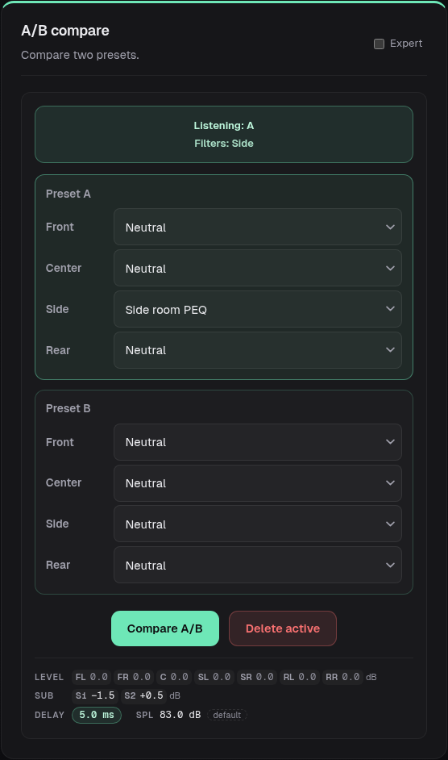</a>
  <a href="media/screenshots/surround-expert.png">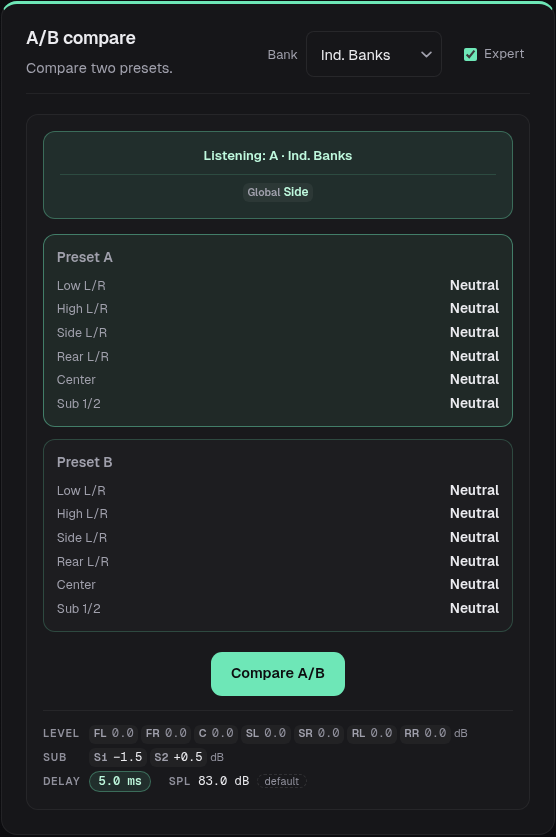</a>
</p>

*Easy (left) compares the Global speaker-group selections. Expert (right) exposes the bank selector; Ind. Banks lists the area-bank assignments in both slots and leaves Global separate.*

### 5.7 Sample rate

**Sample Rate** defaults to **Auto**: the PipeWire graph and DAC follow the effective playback rate of the current source (local files, radio, TIDAL, Spotify, Qobuz, Bluetooth can differ). A source rate the selected output does not support plays at the highest supported rate below it (for example 96 kHz on a 48 kHz-only card, 384 kHz on a 192 kHz device), and PipeWire resamples the source; supported rates always stay native. A fixed rate forces one clock; FXRoute rejects rates the selected output does not support and caps processing at 384 kHz. Switching policy automatically restores the track and playing or paused state after the audio path changes; seekable tracks retain their position and radio reconnects live. Use Auto when sources with different native rates play together; use a fixed rate when the DAC, DSP chain, or external hardware needs one clock.

**SRC Quality** is independent of Sample Rate: **Low** uses libsoxr VHQ, **Standard** (default) uses pinned CPU-only SoX 16.2.1, and **High** uses the approved extended profile from that same binary. One common PipeWire converter applies the choice across provider and input boundaries, retaining PipeWire clock matching. Selecting a mode uses the same automatic playback handoff as a Sample Rate change: FXRoute rebuilds the audio adapters and restores the track, queue and playing or paused state. Seekable tracks continue from their previous position; radio reconnects to the live stream. Measurements and selected or active input sessions block a change. Unequal-rate playback keeps a provisional 750 ms minimum startup reserve, with a bounded 3,750 ms startup wait for the first usable output under load. See [Common playback SRC](docs/playback-src.md) for profiles, API, build and tested coverage.

Some USB interfaces offer fewer hardware channels at higher rates. For known profiles (Scarlett 16i16, 18i16, and 18i20 4th Gen), FXRoute offers every supported rate — for example 18 channels at 44.1/48 kHz, 14 at 88.2/96 kHz, 10 at 176.4/192 kHz on the 16i16 — and switches the channel inventory internally to the tier that carries the rate. There is no separate tier control: Fixed and Auto both select a rate, and the rate determines the tier. Switching tiers re-probes the device (audible relay clicks), so keep track changes within one band when that matters. **Auto** follows the source rate and switches tiers with it; it never resamples to stay inside an inventory. A measurement runs at 48 kHz whenever the measurement input offers it. With **Auto** that includes an input of the output interface itself while the device sits on a higher tier: the first sweep re-probes it into the 44.1/48 kHz tier. With a **Fixed** rate the device stays on its tier, so its own input measures at the rate it is running at (Fixed 96 kHz → 96 kHz), while a separate microphone limited to 48 kHz still measures at 48 kHz and re-probes the device for the sweep. An input without 48 kHz measures at the running rate when it supports it, otherwise at its lowest rate. FXRoute returns the device to the playback rate and its tier after the Measure window is closed. A local track or radio stream playing before the window resumes afterwards; starting or stopping something during the window keeps the new state instead.

## 6. Measurement assistant

Open **Measure** on the DSP page. The assistant plays sweeps through the active DSP chain, records the response from a host microphone, and turns saved measurements into PEQ or FIR/convolver corrections. A microphone input is selected in **Setup**.

The workflow panel holds: **Measurements** (Setup, Start Sweep → Run Single Sweep / Start LR Repeat / Advanced), **Subwoofer** (Auto Sub Optimize, only when subs are routed), **Speaker Auto Alignment** (only for a clean 2-, 3-, or 4-way crossover), and **Calibration** (AV Sync, SPL Calibration, Level Matching, and bank-dependent Polarity Check). Only one measurement runs at a time; while Auto Sub Optimize or a sweep is running, the competing start controls are refused rather than queued silently.

[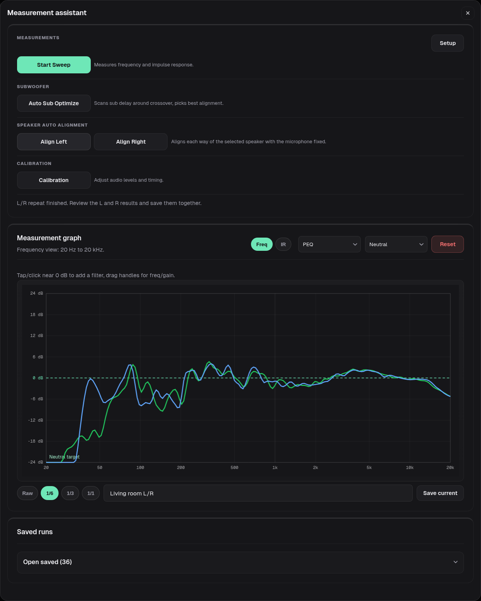](media/screenshots/measurement.png)

### 6.1 Setup: microphone, electrical reference, and files

**Setup** holds the capture input and the reference material:

- **Host capture input** — the microphone (or interface) the sweeps are recorded from, plus **Mic input channel**.
- **Electrical reference input** — a second channel on the same capture interface that records the sweep itself (a loopback of the output signal) next to the microphone. On an input with three or more channels FXRoute offers **Electrical Ref L** and **Electrical Ref R** instead of the shared field. A reference that equals the microphone channel is disabled with the note *Electrical reference disabled: mic and reference must use different input channels.*
- **Calibration file (optional)** — a microphone calibration file, uploadable, selectable, exportable, and deletable.
- **House curve / target file (optional)** — a REW-style target curve, with the same upload/export/delete handling.

The electrical reference is what makes the timing analysis trustworthy: the direct-arrival and L/R timing values FXRoute reports come from the electrical signal when one is configured, and are measurably more precise than acoustic-only captures. Where no reference is configured, FXRoute still measures and still works — it simply reports lower-confidence timing, which matters most for the aligned FIR modes. Speaker Auto Alignment needs the electrical reference and does not start without it (section 6.5).

Each saved run shows how its timing was obtained: **Electrical reference active**, **Electrical reference fallback** (the configured reference was clipped, too quiet, not sharply or confidently detected, not distinguishable from noise, or the acoustic arrival preceded it, so a host-monitor reference was used), or **Acoustic-only timing**. The saved-run line also reports the measured delay and, for L/R Repeat, the spread across the accepted repeats. A tooltip explains that the L/R delta is calculated as Right minus Left, so a positive value means the right channel arrives later.

### 6.2 Measuring area and single sweeps

The **Start Sweep** menu shows the **Measuring area** before you run anything. The area is the DSP filter bank currently selected on the DSP page — always **Global** in the Easy view, any bank in the Expert view (section 5.1):

- **Global** (Stereo and Stereo + Sub) — *Whole system; all area banks active.* The sweep plays every active role.
- **Global · <group> + Sub** (Surround) — the group chosen in the sweep menu, measured together with the subs: *Only selected speakers and subs play.* The sweep plays that group's speakers plus both sub roles, so the result covers the speaker together with its share of the sub bus.
- a specific bank (for example `Sub 1`, `Low L/R`, `Main L/R`) — *Only <bank> stays audible; every other output is muted for this sweep.* The sweep plays that bank alone, so the result is the response of that way without the rest of the system.
- **Ind. Banks** — *Whole system as listened (every bank on its A/B side); not importable.* (In Surround with more than one speaker group routed, the sweep menu's group chips narrow the sweep to that group and the subs: *Only selected speakers and subs play.*) The frozen result records each bank's listened preset and the joint A/B side. It can be saved, graphed, compared, and merged, but it owns no bank to commit into: the filter import and the PEQ and convolver assistants refuse it with *This result was measured through Ind. Banks; it can be saved and inspected but not imported into a bank.* **Advanced** is refused for the same reason.

In **Surround** the Global area is measured per speaker group, and only a group with its own routed speaker can be chosen; every other speaker group is muted at the outputs, so the microphone hears the measured group and the subs. Groups other than Front also silence the front pair's sink feed for the take, because its bass would otherwise reach the measured group through the shared bass bus. The subs stay audible on both sides, and a position without its own speaker keeps its fold-down sends silent instead of exciting them (section 5.6).

With **Global** or a stereo pair bank — a stereo Surround group included — you can narrow the sweep to one side with the `Left` / `Stereo` / `Right` chips; a mono bank always sweeps both inputs at once and hides the chips. **Start LR Repeat** is hidden for mono areas and all Sub banks, including a stereo Sub L/R pair. Context-inappropriate actions are hidden rather than greyed out; a running action remains cancellable. The single-sweep button is **Single Sweep**; the status line reports the input level (`Peak … dBFS`, `Peak < -90 dBFS`, or `CLIP`).

### 6.3 LR Repeat

**Start LR Repeat** measures left and right three times each at one fixed microphone position and shows one combined result. Its label becomes **Cancel measurement** while it runs. **Save current** stores the pair as `<name> · L` and `<name> · R`; the internal repeats are never added to the saved list. The saved line reports how many repeats were accepted and how much their timing spread. Use the mode when you want a more dependable L/R pair for correction or the aligned FIR modes.

### 6.4 Advanced: speaker and room measurement

**Advanced** guides a multi-position measurement and is labelled *Combined Speaker and Room Measurement*:

1. Direct response · Left — microphone about 1 m from the left speaker on its listening axis
2. Direct response · Right — same for the right speaker
3. Main listening position — move the microphone to ear height at the main listening position; left and right are measured automatically
4. Left listening position — move the microphone 20–30 cm left of the main listening position
5. Right listening position — move it 20–30 cm right

The wizard follows the selected **Measuring area**, so the step list and the model it produces match what you measure:

- a stereo area — a pair bank, or the Surround groups **Front L/R**, **Side L/R**, and **Rear L/R** (with Crossover On the way pairs) — takes the steps above, and with subs routed ends with the subwoofer alignment check.
- a mono area — the Surround group **Center** — measures one channel instead of a pair: one direct response, the main listening position, and the two listening positions are captured as a single **Center + Sub** model (the label drops the `Global · ` prefix and keeps the group name, for example `Center + Sub · measuring area`). There is no L/R comparison and no subwoofer alignment check.
- **Sub** and **Ind. Banks** hide Advanced. Sub banks offer a single sweep and Auto Sub Optimize; Ind. Banks owns no bank to receive the filter model (section 6.2).

In **Surround Global** the open Advanced dialog shows a speaker row (`Front`, `Center`, `Side`, `Rear`, `All`) above the first step, so the pair or the single Center can be chosen without leaving it. A group chip sets the same speaker selection as the chips in the sweep menu; the room view places the speakers for the group (front wall, side walls, behind the seat). **All** measures every routed group by microphone position instead of group by group: first each group's nearfield direct response, one start per speaker (two for a pair, one for Center); then a single start at the main listening position that measures every routed group in turn — each group's captures and its subwoofer alignment check, the mono Center without one; then a single start at the left listening position for every group; then one at the right. The header names the group of the current step and its position in the run, and the first step of each listening position says that all speakers are measured automatically. A failed subwoofer alignment check is repeated while the microphone is still at the main position, before the run moves on; a cancelled or failed position resumes with the speakers still missing there. The speaker row is locked once the first measurement is taken; close and reopen the dialog to change it.

The room view shows the subwoofers only for a run that measures them: the whole-system Global area, a Surround group (its target keeps the subs audible) and a subwoofer bank; an individual speaker bank mutes every sub and shows none.

[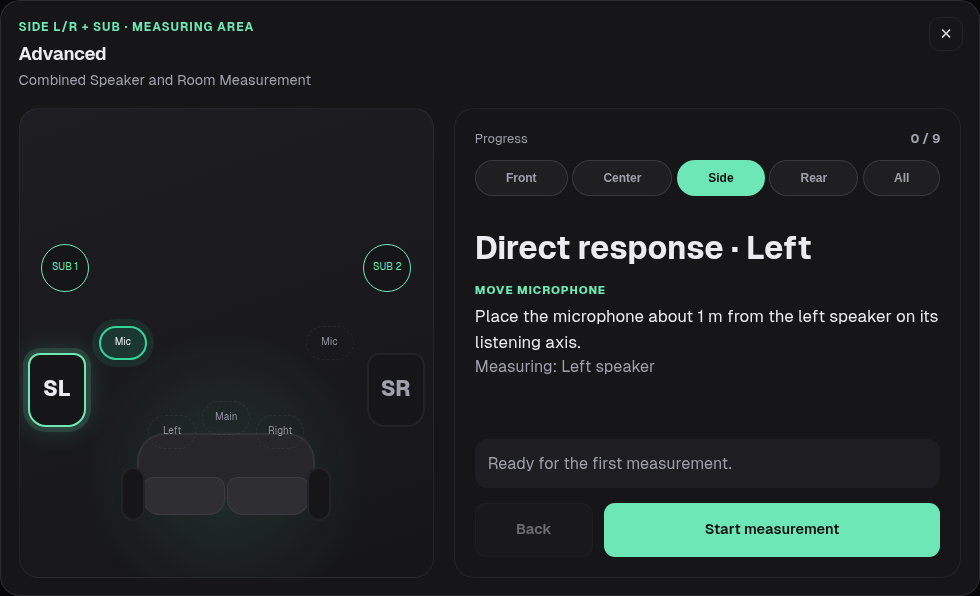](media/screenshots/room-diagram.png)

When subwoofer routing is active, a stereo area ends with a **Subwoofer alignment check** that returns the microphone to the main listening position and measures the summed L+R response with the subs in circuit — in the **All** series inside the main-position start of its group. A Surround group keeps the subs audible for it; an individual pair bank mutes them, so its check covers only the bank's own L+R sum. The wizard label reflects the derived sub layout (`Stereo`, `2.1`, `2.2 Mono`, `2.2 Stereo`).

FXRoute validates position, L/R timing, and the summed response and asks you to repeat a step after correcting it (**Repeat measurement**). Keep the microphone at ear height and move it only when a step asks. Use the electrical reference input when available.

When the run finishes, the dialog lists what was captured, compares left and right, reports the gated direct lower limit, and offers **Open filter generator**. That hands the combined speaker and room model to the **Convolver** assistant as a left/right pair (`Advanced … L` and `· R`) so you can turn it straight into a FIR preset.

A run over **All** speakers ends with **Show results** instead: the models of every group appear together on the graph, with a colour key under it, and **Save current** stores them as one set named `<name> · <group> · L` / `· R` (Center without a side). Saved, they are ordinary runs: tick one group's L and R to work on them in the Convolver assistant. Ticking saved runs that were all measured for one speaker group also selects that group's speaker chip, so a filter made from them is bound to the group they were measured for.

### 6.5 Speaker Auto Alignment

**Speaker Auto Alignment** appears only for a clean crossover topology: Crossover On, 2, 3, or 4 ways without routing issues, both filters set at every crossover point (a way whose inner high-pass or low-pass is **Off** hides it). It always aligns the whole speaker through the **Global** bank: the **Easy** view offers it even when the Expert view has another bank selected, while the Expert view hides the section as long as a bank other than Global is selected. In **Surround** the Global bank is group-scoped, so Speaker Auto Alignment is not offered there. **Align Left** and **Align Right** run one side at a time with the microphone fixed, and a configured electrical reference is required: the verification take cannot run on the microphone alone, and a reference on the microphone's own input channel is refused before the first sweep.

The workflow measures every way of that speaker in one shared planning take, measures each way on its own for level and provenance evidence, proposes an added delay (and, where the evidence supports it, an added gain trim) per way relative to the latest way, then takes one shared *verification* measurement and only commits when the verification passes. Delay and gain are written into the committed output state for those ways; polarity, crossover, routing, subs, and extras are never touched. The result table lists each way (`Low`, `Low-Mid`, `Mid`, `High`) with its added **Delay**, added **Gain**, and **Isolation** — how far its arrival stood above its neighbours in the planning take and in the verification. The line under it reports the timing spread before and after against the verification limit (`spread … → … ms (limit … ms)`) and the level spread between the ways as an advisory. The status line states the outcome:

- *Speaker Align Left verified and applied.* (with the committed revision)
- *Speaker Align Left not verified: … Previous delays kept.*
- *Speaker Align Left trial verified; nothing applied.*

The planning and verification measurements are named `Speaker Align <Side> · Before (planning)` and `· After (verification)`, land on the graph, and can be saved like any other run. **Cancel Alignment** stops a running job.

**Align** values stay within −40…+40 ms. When a planned delay would push a way past +40 ms, FXRoute moves every output stored for the current mode — both sides, the subs, and outputs that are not routed right now, such as Main L/R while Crossover is On — by one common offset so the largest value lands on +40 ms. The timing between all outputs stays exactly as planned, also after a later crossover or routing switch, but the **Align** values shown in the Crossover and Subwoofer cards change by that offset. If an output cannot take the offset within −40…+40 ms, the run is refused before anything is applied and the message names that output.

Keep the setup fixed while it runs. FXRoute refuses to continue — and says so — if the output state moved after the job started, if another measurement or alignment is already running, if the ways cannot be separated by at least 10 dB in the planning take, if the microphone or reference input changed between takes, or if the microphone gain was raised mid-run.

### 6.6 Auto Sub Optimize

**Auto Sub Optimize** scans subwoofer alignment candidates around the currently configured values, then verifies and applies the winner for the *current derived sub layout*. There is no mode to pick — the routing decides which optimizer runs:

- **Mono sub** — one shared alignment for a single sub, checked against both mains
- **Dual-mono subs** — Sub 1/Sub 2 alignment combinations evaluated as one dual-sub system
- **Stereo subs** — left and right sub/main branches optimized separately

In **Surround** only the Mono sub and Dual-mono subs optimizers exist, with the front pair acting as the mains.

The button becomes **Cancel Auto Sub** while a run is in progress, and the subwoofer controls are locked during it; manual sweeps are refused until it finishes. The progress line names the current stage (level check, main reference, coarse scan, fine scan, per-sub scans, combined matrix, polarity check, level match, deep-bass check, final check). Delay candidates are scanned around the current value and never leave the −40…+40 ms **Align** range, level corrections stay within ±6 dB, and every winner is verified against the selected target curve and checked against the full-scale limit before it sticks; a candidate that is not clearly better keeps the existing alignment, and the result line says so. Reloading the page reattaches to a running Auto Sub job, and to one that finished within the last 10 minutes.

If you know a sensible starting delay (for example from a subwoofer manual), set it in the Subwoofer card first — the scan centers on it. Keep the microphone fixed and stay quiet during the run. The result line reports the applied values; for two subs it also names the layout (`Auto Sub 2.2 applied …`, `Auto Sub 2.2 Stereo Bass applied …`).

The baseline and confirmation measurements stay on the graph as `Before` and `After` traces; **Save current** stores one entry per take and side (with the default name `AutoSub Before L`, `AutoSub Before R`, `AutoSub After L`, `AutoSub After R`). A saved Auto Sub run shows the run's target curve and final sub settings instead of a timing line, and names the subs by the layout it optimized, for example `Target: Neutral · Sub L +3.4 dB · −0.2 ms · N · Sub R +1.0 dB · −0.8 ms · N`: **Sub** for a mono sub, **Sub 1** / **Sub 2** for dual-mono subs, **Sub L** / **Sub R** for stereo subs.

**Recommended order with EQ or convolver correction:** set crossover and levels roughly, run Auto Sub Optimize, verify with a normal measurement, create and enable the correction from that state, then run a final verification measurement. Repeat the optimizer only if a new correction materially changes phase or delay around the crossover.

### 6.7 SPL Calibration

**SPL Calibration** plays **−23-LUFS pink noise** (83 dB SPL target, C-weighted / Slow) to level-tune the output profile. Press **Start noise**, then enter the **Measured SPL** reading and press **Save / Apply**. With a UMIK-1, UMIK-2, or Dayton Audio UMM-6, FXRoute measures the SPL automatically and fills the field, but only when the selected input, the selected calibration file, and the capture gain all match that microphone's requirements; otherwise it says why and falls back to manual entry. Read the meter about a second after the noise starts and average over a few seconds. The automatic measurement averages the last three seconds of its capture and refuses a run whose noise level was still rising in that window (for example after a slow start); it reports that and asks you to repeat the measurement. Autogain and Loudness are temporarily neutralized during the run and restored exactly when it stops, saves, or fails. A saved calibration only affects playback with Loudness on, and the status line reminds you of that. A calibration belongs to the output it was measured through (amplifier, speakers and room differ per output): **Save / Apply** stores it for the output that renders now, and only that output's Loudness work point reads it. An output without a calibration of its own uses the 83 dB default and the overview shows it as *default*; switching outputs never carries another output's value along, and each output keeps its own. The output mode (Stereo, Stereo + Sub, Surround) is not part of that identity. A reading is refused when the output changed between the measurement and the save, and an automatic measurement is refused when the output changed while it ran; measure again for the output you want to calibrate. A calibration saved before outputs had their own is kept but not used until you measure again.

#### Level Matching and Polarity Check

**Level Matching** is available in every bank context except subwoofer banks: with a Sub, Sub 1/2, or Sub L/R bank selected the Calibration menu keeps only SPL Calibration, because Auto Sub Optimize owns sub level and polarity. It stores cut-only calibration per output mode, not per preset or bank. Stereo/Crossover measures logical Left and Right, with every crossover way of a speaker playing together. Surround shares one calibration family: Front establishes the reference for staged measurements of other speaker banks, while Global/Ind. Banks measures all routed logical speakers in one run. Subs are excluded; Auto Sub Optimize handles their levels. A successful Stereo remeasurement or reset replaces legacy bank-specific calibration trims without changing manual gain, alignment, polarity or other modes. A **Reset to 0 dB** button drops the stored raw levels of the area's family and commits 0 dB to the Level Calibration slots it owns; other levels, filters, Auto Sub and DSP settings stay untouched.

Unequal existing calibration trims across a speaker's crossover ways are temporarily neutralized for the measurement, then the original processing is restored before the result can be applied. A take the sweep never reached (amplifier off, wrong microphone, loud room) has no direct arrival and is refused before any level is stored, so noise never enters the table. Failed or cancelled measurements leave the saved calibration unchanged. A failed DSP restore stops playback rather than leaving temporary trims active. Stored Surround readings of speakers no longer routed do not influence the current target level.

**Polarity Check** diagnoses speaker wiring only and changes no setting. It appears for individual speaker banks, not Global, Ind. Banks or sub banks; plain Stereo without bank selection keeps its speaker-pair check. It reads the first high-frequency pulse and does not optimize phase or alignment between speaker groups. The check sweeps through the whole active chain, so a crossover, PEQ or convolver that rotates the phase of the 4–14 kHz range would make the reading follow the filter instead of the wiring. Then the speaker reads **Filter in band** instead of Correct or Reversed. An active Loudness, Bass Enhancer, Crystalizer, Maximizer or Upmixer, or a Global PEQ or convolver that cannot be modelled, reads **DSP not checkable**; switch the named stage off, or select Direct for Global, to check the wiring. Ordinary room-correction PEQ below a few kHz, bass-management high-passes and plain gain or delay stages never withhold a verdict.

#### AV Sync

**Calibration → AV Sync** sets the **total electronic audio delay**, not an extra delay on top of the DSP chain. Stereo, Stereo + Sub, and Surround keep separate targets, independent of the selected filter bank. **Save / Apply** stores the target; the live engine credits input latency, fixed SRC buffering, DSP processing, intentional delays and speaker alignment, then adds only the remaining common delay. Changes to presets, filters, convolver IRs, Loudness FFT, upmixer, Direct or sample rate update the accounting automatically.

The dialog shows the achievable delay at the Front/Main reference speaker and its current range. A target below the minimum cannot advance audio; a target above the maximum reaches the delay capacity instead. The target remains stored so it can become reachable after the chain changes. Alignment and automatic compensation share a **500 ms** capacity, including balancing before mixed Surround sends. Unequal-rate SRC currently retains at least **750 ms** of timeline buffering in every quality mode; equal nominal rates skip that reserve. The input credit includes the observed fixed SRC offset on the routed input and hardware paths, including any startup readiness extension retained after real audio begins. Engine first-output time is covered by that reserve, not added again. Unrelated adapters and paused app taps during an external-input session or measurement are not credited. Different simultaneous path offsets make live timing unavailable rather than selecting a guessed total. Device buffering, acoustic travel and variable clock matching are excluded; AV Sync does not delay video.

Time Alignment, Speaker Auto Alignment and Auto Sub Optimize retain their own settings. Automatic balancing compensates only electronic timing **changes since their calibration basis**, never the already measured path spread. Successful alignment measurements capture the timing actually used for their sweeps. Partial measurements keep the other speakers' relative timing. Older calibrations without timing evidence safely adopt the verified current rendering, without guessing their original DSP setup; the dialog recommends remeasurement for a measured basis.

New correction IRs made by FXRoute carry per-channel timing metadata, separating algorithmic delay from deliberate aligned-phase delay. An imported IR without this metadata has unknown timing: the dialog warns that automatic balancing is unavailable and its reported total is not guaranteed. FXRoute does not infer delay from an arbitrary IR's length. Digital inputs routed through the Surround helper credit **2818 frames at 48 kHz (58.71 ms)** for both PCM and AC-3/DTS; direct PCM paths outside that helper have no such credit.

### 6.8 Graph, target curves and the correction assistants

- The **Measurement graph** shows the frequency response from 20 Hz to 20 kHz with smoothing (**Raw**, **1/6**, **1/3**, **1/1**); the **IR** toggle shows a compact impulse-response preview where available. The preview is a timing/reflection sanity check, not a full IR export.
- The assist selector switches between the **PEQ** and **Convolver** assistants, and the target-curve selector offers **Neutral**, **Bass Shelf**, **Harman-style**, **Bruel & Kjaer-style**, plus any uploaded house-curve file and **Create Custom House Curve…**.
- **PEQ assistant** — sketch up to 12 temporary filters (F1–F12, or click the graph near the 0 dB line), edit frequency, gain, Q (0.1–20), and type, and use **Take L / Take R / Take Both** to build a new PEQ preset in the selected filter bank. The graph draws each filter exactly as the DSP engine renders the stored values; shelves use Q like every other type.
- **Reset** discards the unsaved capture state and returns the open assistant to its defaults: an unsaved single sweep, pending L/R Repeat takes, and Auto Sub takes go together with the PEQ filters (and the target curve back to **Neutral**) or the Convolver target curve, correction range, and limits. Saved runs are kept, and a staged PEQ draft survives; changing the target curve still invalidates a staged FIR. Reset only acts in the frequency view and stays locked while a start, a save, or any active measurement job is in flight.
- **Custom House Curve** — create up to 8 frequency/gain points (P1–P8) and save it as a target curve.
- **Convolver assistant** — choose the visible saved runs (exactly one Left and one Right for stereo), then set target curve, correction range, **Max Boost** / **Max Cut**, **Dip Guard**, tap length, and the phase mode:
  - **Linear phase** — symmetric FIR
  - **Min. phase** — default for broad room/speaker correction
  - **Min. phase aligned** — minimum-phase correction with measured L/R direct-arrival alignment
  - **Hybrid aligned FIR** — minimum phase below 180 Hz, crossfading to a delay-compensated linear correction above 550 Hz

  There is no sample-rate choice: a generated filter is written at the sample rate of the measurement it is built from, and the convolver resamples it to the engine rate when the preset loads. Every resampled filter carries a short faded lead-in (32 sample periods, about 0.7 ms) that the engine reports as convolver latency, so level, AV Sync and the balance between outputs account for it. The tap length stays as selected. Left and Right must come from measurements taken at the same rate.

  The aligned modes need separate saved L/R measurements with valid direct-arrival timing. FXRoute blocks filter creation when the measured L/R timing offset is unsafe; the graph shows the arrival relation (for example `L arrives 5.27 ms later than R`).

  **Create** (PEQ and Convolver) commits a preset only into the bank its source measurements were taken for: their frozen mode, bank and speaker group must be the ones the preset is committed into, and their measured roles must be the roles that bank plays on the selected outputs. Sample rate, processing, output device and reference tap are not compared. An Ind. Banks result can be saved and inspected but never committed, and a result without a frozen target (Auto Sub results carry none by design) is refused and has to be measured again.

[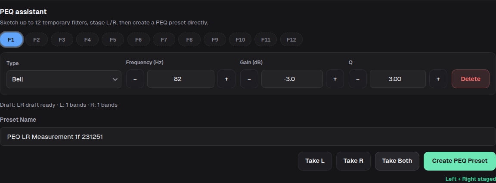](media/screenshots/peq.png)

[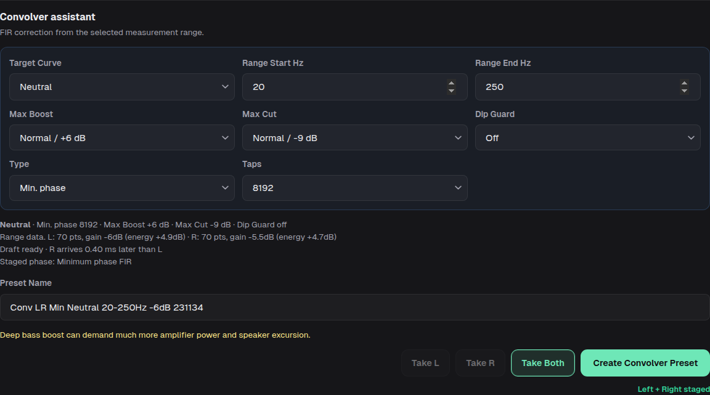](media/screenshots/convolver.png)

### 6.9 Saved runs

**Save current** keeps a run under a name of your choice. Saved runs appear under **Saved runs**; the list can be collapsed with **Open saved (N)**. Each row shows the measured area as a badge — a bank (`Low L/R · Stereo + Sub`, `Rear L/R · Surround`), a Surround group (`Global · Front L/R · Surround`, tooltip *measured with the subs*), or the Ind. Banks aggregate as listened (`Ind. Banks · B · Surround`, tooltip *measured whole system as listened*) — the capture input and channel with its mic and reference input channels, the timing line, and a quality summary. The measurement name field shows the same area in its tooltip.

Checkboxes show/hide runs on the graph (a hidden run is still available as a dashed compare trace), a run's name links to its stored file, and the toolbar offers **Select all**, **Delete selected**, **Merge selected**, and **Close**. Merge combines the checked runs into one new measurement under a name you choose; FXRoute refuses to merge runs that captured different areas, rates, processing or devices, so merge one area at a time. There is no rename action — a name is fixed when the run is saved or merged.

## 7. Technical settings

The FXRoute logo opens **Technical settings**:

- **Providers** — install, update, or remove each streaming backend, show/hide its tab, and connect or disconnect accounts. *Installed* is a fact about the machine; the checkbox only decides whether the tab is shown.
- **Audio Output** — output device, **Sample Rate** policy, **SRC Quality** (Low, Standard, High), **Mode** (Stereo, Stereo + Sub, Surround), **Crossover** (Off/On), and **Output Routing** (on devices with more than two outputs)
- **Source** — active input mode, plus Bluetooth and STDIN status
- **Music Library** — local folder or a discovered/entered SMB share
- **Device Name** — the `<name>.local` address on the LAN (lowercase letters, digits and hyphens)
- **Maintenance** — installed version, update check, update, and update log
- **HTTPS certificate** — download link when the local HTTPS proxy is enabled

## 8. Maintenance

**Technical settings → Maintenance** shows the installed version, checks for updates, and runs them. Updates are blocked while the checkout contains uncommitted changes; **Restore to Public Release** then saves tracked changes as a patch and untracked files as an archive (both in `backups/`) and resets the checkout to the clean public release — use it only when you no longer need the local changes. User data, music, config, and the runtime cache are not affected. A restart is scheduled after a successful update or restore.

## 9. Local HTTPS certificate

When the optional HTTPS proxy is enabled, FXRoute runs a local certificate authority for the audio PC. Download its certificate from **Technical settings → HTTPS certificate** and import it as a trusted CA only on devices you control on your own LAN. If the CA is regenerated, client devices need the new certificate again.

## 10. Home Assistant / external automation

FXRoute exposes `GET /api/power/state` as a read-only power hint. The payload has four fields: `amp_should_be_on` (boolean), `reason` (`playback`, `measurement_window`, `bluetooth`, `external-input`, `stdin`, or `idle`), `playback_active`, and `measurement_window_open`. `amp_should_be_on` is true while local, TIDAL, Spotify, or Qobuz playback is active, while the measurement assistant is open, while Bluetooth audio is streaming, while an external input is routed, or while a STDIN stream is active; `reason` reports the first matching state in the order measurement window, playback, Bluetooth, external input, STDIN, idle. A Home Assistant or similar automation can use it to switch an amplifier smart plug; FXRoute needs no MQTT broker and never controls the plug itself.

For a **Surround capture pair** (including S/PDIF), routing alone is not activity: the power hint also requires a detected input signal or fresh external presence. FXRoute monitors the selected pair even with **Auto** off. PCM above dither level and encoded programme count as signal; digital silence and null/pause bursts do not. The hint survives short pauses and releases after 60 seconds without signal (up to 10 seconds for missing capture or a reported lost digital lock). A receiver lock or the ingress reporting `codec: pcm` alone does not keep it on. A manually selected input remains selected and routed while idle; custom multichannel mappings retain their routing-based hint. Home Assistant's configured idle timer starts when it observes `amp_should_be_on: false`, after this signal hold.

A minimal configuration polls the endpoint as a binary sensor and switches the plug on when playback starts and off after an idle period:

```yaml
rest:
  - resource: "http://fxroute.local:8000/api/power/state"  # Adapt host/port if needed.
    scan_interval: 5
    binary_sensor:
      - name: "FXRoute amp should be on"
        value_template: "{{ value_json.amp_should_be_on }}"

automation:
  - alias: "FXRoute amp on"
    trigger:
      - platform: state
        entity_id: binary_sensor.fxroute_amp_should_be_on
        to: "on"
    action:
      - service: switch.turn_on
        target:
          entity_id: switch.verstaerker_steckdose  # Adapt to your smart plug.

  - alias: "FXRoute amp off after idle"
    trigger:
      - platform: state
        entity_id: binary_sensor.fxroute_amp_should_be_on
        to: "off"
        for:
          minutes: 20
    action:
      - service: switch.turn_off
        target:
          entity_id: switch.verstaerker_steckdose  # Adapt to your smart plug.
```

FXRoute can also take an external presence status for any known input key: `POST /api/audio/input-presence` with `{"inputKey": "<key from /api/audio/source-mode>", "present": true}`. The key is the same input key the footer switcher uses. The report is a heartbeat: repeat it while the source is present; it reads as absent once it is older than 30 seconds, and `{"present": false}` clears it immediately. Unknown keys are rejected with 400. An armed input switches and returns exactly as with a local signal, because the external presence is OR-ed with the local detection; `/api/audio/source-mode` gains a per-input `presence` flag, and `GET /api/audio/input-presence` lists the currently fresh reports (fail-closed: expired reports never count).

A minimal Home Assistant automation reports a turntable sensor while it stays on:

```yaml
rest_command:
  fxroute_input_presence:
    url: "http://fxroute.local:8000/api/audio/input-presence"  # Adapt host/port.
    method: POST
    content_type: "application/json"
    payload: '{"inputKey": "{{ input_key }}", "present": {{ present | lower }}}'

automation:
  - alias: "FXRoute: turntable presence heartbeat"
    trigger:
      - platform: state
        entity_id: binary_sensor.plattenspieler
      - platform: time_pattern
        seconds: "/15"
    mode: restart
    action:
      - service: rest_command.fxroute_input_presence
        data:
          input_key: "alsa_input.usb-Focusrite-00.pro-input-0::pair:1-2"  # Key from /api/audio/source-mode.
          present: "{{ is_state('binary_sensor.plattenspieler', 'on') }}"
```

## 11. If something fails

1. Start with **Radio** — it is the simplest source and proves output and DSP routing.
2. Check the playback bar: does it show a track and a level?
3. Open **Technical settings** and confirm the output device. The line under **Output Routing** names the derived topology and, when the routing is incomplete, the first problem it found.
4. Restart the service and watch its log:

```bash
systemctl --user restart fxroute
journalctl --user -u fxroute -f
```

5. If the native DSP graph is the suspected problem:

```bash
wpctl status
pw-cli ls Node | grep fxroute_dsp
```

6. Reload the browser when it reports a disconnect after a service restart.
7. If a measurement refuses to start, check the **Measuring area** and the microphone in **Setup**: a mono measuring area disables LR Repeat, and a busy or stale output state blocks the sweep.
8. If a Surround layout only plays the front pair, check the source: stereo PCM and stereo AC-3 stay stereo by design, and only Dolby Digital or DTS Core is decoded. `GET /api/audio/surround` reports what the surround ingress sees.

## 12. What FXRoute expects

- a Linux user-session audio machine (desktop, or headless with user services enabled)
- PipeWire running in that session, with the FXRoute DSP engine in the same graph
- browsers on the local network as the control surface
- a DAC, amp, active speakers, headphones, or similar listening setup
- for more than stereo: an output device with at least three channels, and roles assigned to it in **Output Routing**; in **Surround**, multichannel programme can come from a digital (S/PDIF) input (Dolby Digital or DTS Core), a multichannel **Custom Mapping**, or **STDIN**, and stereo sources can use the **Upmixer**
- optionally a Spotify client/spotifyd, qbzd, or TIDAL backend for provider playback
- a host microphone input for measurement; a calibrated USB measurement mic enables automatic SPL calibration, and an electrical reference channel on the same input enables precise timing, Speaker Auto Alignment, and the aligned FIR modes

FXRoute does not run as a system daemon and does not replace Spotify Connect or Qobuz Connect — it controls the local players through the user session.
