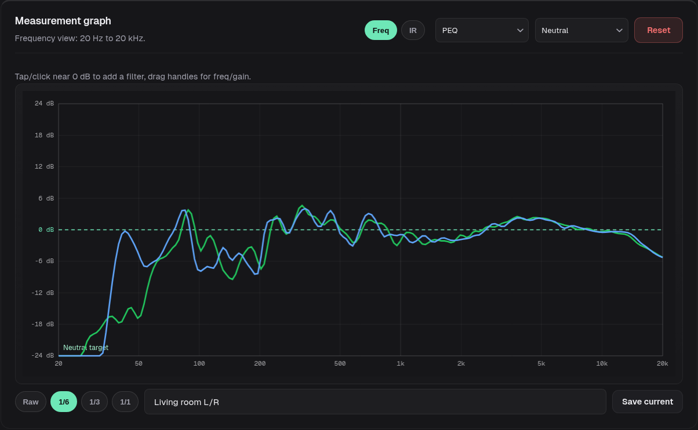

# FXRoute

FXRoute is a browser-based control surface for a Linux hi-fi audio box. One small PC or ARM board with a PipeWire user session becomes the source and DSP hub for local music, internet radio, Spotify, Qobuz, and TIDAL — controlled from any phone, tablet, or laptop on the local network.

Radio, the music library, the streaming providers, the native DSP engine, and the room-measurement tools all in one interface. You browse and play from the couch; FXRoute owns the audio session, the DSP chain, the output routing, and the measurement on the audio machine.

## Download

Start from [FXRoute releases](https://github.com/CobbyCode/fxroute/releases). The release notes list every published artifact and where to fetch it: the Raspberry Pi 4 / Pi 5 SD-card image (GitHub Release) and the x86_64 Ubuntu 26.04 installation ISO (SourceForge). Write the image or ISO to disk, boot it, and finish the web onboarding.

No new hardware? Try the [web demo](#web-demo) first. Already running Linux on the audio machine? Use the [installer](#install) instead.

## Web demo

Try the interface without any audio hardware, directly in your browser: https://cobbycode.github.io/fxroute/

The demo is the real FXRoute frontend — same UI — with simulated backend state for playback, DSP, radio, and measurement, so every view is explorable in a normal browser.

<p align="center">
  <a href="media/screenshots/radio-overview.png"></a>
  <a href="media/screenshots/dsp.png"></a>
  <a href="media/screenshots/measurement-graph.png"></a>
</p>

Beta 14 demo screenshots (simulated playback and measurements). Click an image for full resolution; the [manual](MANUAL.md) also illustrates routing, Surround Easy/Expert, PEQ, Convolver, and the room diagram.

## What FXRoute does

**Sources** ([manual §4](MANUAL.md#4-sources))

- Local music library with albums, tracks, artists, playlists, favorites, and folders, plus uploads and URL imports; SMB and NFS network shares
- Internet radio with a curated catalog, personal stations, Radio Browser search, and live metadata for Radio Paradise, FIP, SomaFM, and KEXP
- Spotify Connect (desktop client or spotifyd), Qobuz Connect, and TIDAL inside the Library with gapless playback
- Bluetooth, external line, and (on supported boards) USB gadget input, with automatic PCM / Dolby Digital / DTS Core recognition, per-device Custom Mapping, and Auto input switching
- STDIN pipe input for raw PCM from shell pipelines (`decoder | fxroute stdin …`), mono to multichannel

**DSP and output** ([manual §5](MANUAL.md#5-dsp))

- A native DSP engine (`fxroute_dsp_sink`) in the same PipeWire session as playback
- **Stereo**, **Stereo + Sub**, or **Surround**, with free assignment of speaker roles to hardware outputs
- 2-, 3-, or 4-way crossovers and mono, dual-mono, or stereo subwoofers, derived from the routing
- PEQ and convolver presets per filter bank, A/B compare, preset combining, and REW/IR imports
- Output extras (limiter, headroom, autogain, loudness, bass enhancer, tone effect), a Surround upmixer, and Auto or fixed sample rate up to 384 kHz with selectable SRC quality

**Measure and correct** ([manual §6](MANUAL.md#6-measurement-assistant))

- Room and speaker measurement with a host microphone: single sweeps, L/R Repeat, and a guided multi-position Advanced workflow, also per Surround speaker group
- Electrical-reference timing, Speaker Auto Alignment, and Auto Sub Optimize
- SPL calibration (automatic with UMIK-1, UMIK-2, or Dayton UMM-6), Level Matching, Polarity Check, and AV Sync
- PEQ assistant with automatic filter suggestions, custom house curves, and FIR convolver presets in linear, minimum-phase, and aligned modes

**System**

- Control from any browser on the LAN; optional local HTTPS via Caddy
- A read-only power hint for amplifier smart-plug automation ([Home Assistant](#home-assistant))
- In-app maintenance updates, plus the downloadable images above

## Install

**Classic install** on a Linux PC or board with PipeWire:

```bash
git clone https://github.com/CobbyCode/fxroute.git
cd fxroute
./install.sh
```

The installer prepares the system packages, builds the native DSP engine, creates the Python virtualenv, and enables the `fxroute.service` user service. Run it as the audio user; from a root shell on a host with several users, pass that user explicitly with `./install.sh --user <name>`. Custom install targets must be dedicated directories named `fxroute` unless `--local-project` is used (that flag installs in place from the current project directory).

Supported package managers are apt, dnf, zypper, and pacman. Streaming providers are optional and always resolve the current stable upstream release. The provider matrix, first-run authentication, and uninstall behavior are covered in [docs/INSTALLER.md](docs/INSTALLER.md).

## First start

- `systemctl --user status fxroute` — the service is `fxroute.service`.
- Open the UI from any browser on the network:
  - `http://fxroute.local:8000` (mDNS; the name is set in **Technical settings → Device Name**; the downloadable images install a unique id, e.g. `http://fxroute-ab12cd.local:8000`)
  - `http://<host-ip>:8000`
  - `http://localhost:8000` on the audio PC itself
  - `https://<host-ip>` or `https://<device-name>.local` when the optional HTTPS proxy is enabled (HTTP stays reachable)
- Play something from **Radio** or **Library** to confirm audio and DSP routing.
- The music folder is configured in `.env` (`MUSIC_ROOT`); SMB shares and NFS exports are selected or added in **Technical settings → Music Library** and survive restarts. Details in the [manual](MANUAL.md#42-library-and-network-shares).

## Home Assistant

`GET /api/power/state` is a read-only amplifier power hint: `amp_should_be_on` is true while FXRoute plays, measures, or has an active input, so an automation can switch a smart plug. `POST /api/audio/input-presence` is the optional return channel that lets an automation report a source as present. FXRoute does not require MQTT. Payload, rules, and complete configuration examples are in the [manual](MANUAL.md#10-home-assistant--external-automation).

## Documentation

- [MANUAL.md](MANUAL.md) — the user manual: sources, output modes and routing, crossover, subwoofers, Surround, the measurement assistant, and the settings
- [docs/INSTALLER.md](docs/INSTALLER.md) — installer, providers, and uninstall details
- [docs/INSTALL-ISO.md](docs/INSTALL-ISO.md) — the x86_64 Ubuntu 26.04 ISO: install, live session, building it yourself
- [docs/INSTALL-ARMBIAN.md](docs/INSTALL-ARMBIAN.md) — building the ARM64 board images yourself
- [docs/usb-audio-gadget.md](docs/usb-audio-gadget.md) — USB audio input (UAC2) requirements and setup
- Technical background: [Surround path](docs/surround.md) · [playback SRC](docs/playback-src.md) · [HDMI profiles](docs/hdmi-profiles.md) · [AV Sync accounting](docs/av-sync.md) · [input auto-select](docs/input-auto-select.md)
- [CHANGELOG.md](CHANGELOG.md) — release history
- [CONTRIBUTING.md](CONTRIBUTING.md) — how to contribute

## License

AGPL-3.0 — see [LICENSE](LICENSE).
